<p align="center">
  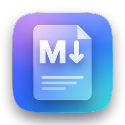
</p>

<h1 align="center">MD Viewer</h1>

<p align="center">
  <b>A free, native Markdown viewer for macOS, made for the plans AI agents write and for Obsidian vaults.</b>
</p>

<p align="center">
  English | <a href="README.tr.md">Türkçe</a>
</p>

<p align="center">
  <a href="https://github.com/suleymanozcan/md-viewer/releases/latest/download/MDViewer.dmg"><b>⬇&nbsp; Download MD Viewer for macOS</b></a>
</p>

<p align="center">
  
  
  
  
</p>

<p align="center">
  Requires macOS 14 or later · Apple silicon and Intel · Developer ID signed and notarized by Apple · Free, no account, works offline
</p>

<p align="center">
  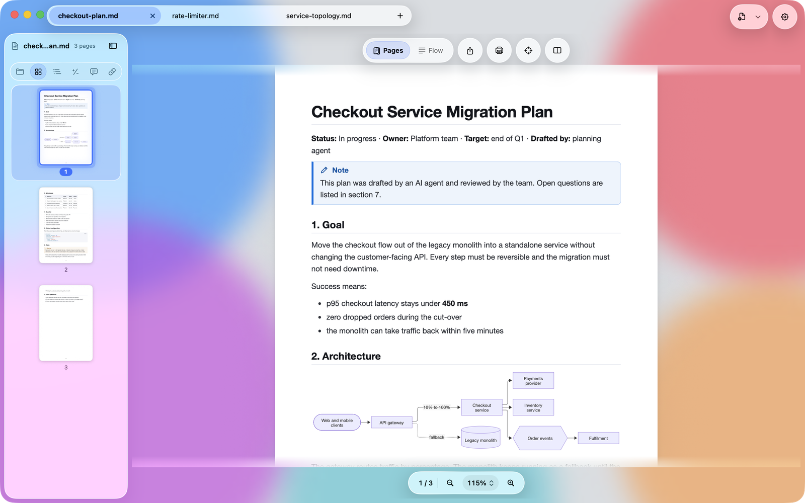
</p>

<p align="center">
  <a href="#why-md-viewer">Why</a> ·
  <a href="#features">Features</a> ·
  <a href="#install">Install</a> ·
  <a href="#keyboard-shortcuts">Shortcuts</a> ·
  <a href="#faq">FAQ</a> ·
  <a href="docs/USAGE.md">Usage guide</a> ·
  <a href="CHANGELOG.md">Changelog</a>
</p>

## Why MD Viewer

- **Read what agents write, while they write it.** Plans, specs and architecture notes from AI coding agents are Markdown. MD Viewer follows the file as the agent edits it, shows what changed, lets you comment on any passage, and hands those comments back to the agent as a ready-made prompt.
- **Made for Obsidian vaults.** Open any note or folder and get wikilinks, embeds, callouts, properties, backlinks, tags, quick switching, vault search and canvases, without starting Obsidian.
- **Light and local.** A native SwiftUI app, a download of about 13 MB, no Electron, no account. Mermaid, KaTeX and everything else are bundled, so it makes no network connections.
- **Free.** No ads, no telemetry, no subscription. Your documents stay on your Mac. See [PRIVACY.md](PRIVACY.md).

## Features

### Reading

#### Pages and thumbnails

Pages mode lays your document out as A4 pages, the way Preview does, with page thumbnails and a clickable Contents list on the left. Headings and small blocks are never split across pages, and a tall table continues on the next page with its header row repeated. Switch between Pages and Flow with **⌃⌘1** and **⌃⌘2**; show Thumbnails with **⌥⌘1** and Contents with **⌥⌘2**.

<p align="center">
  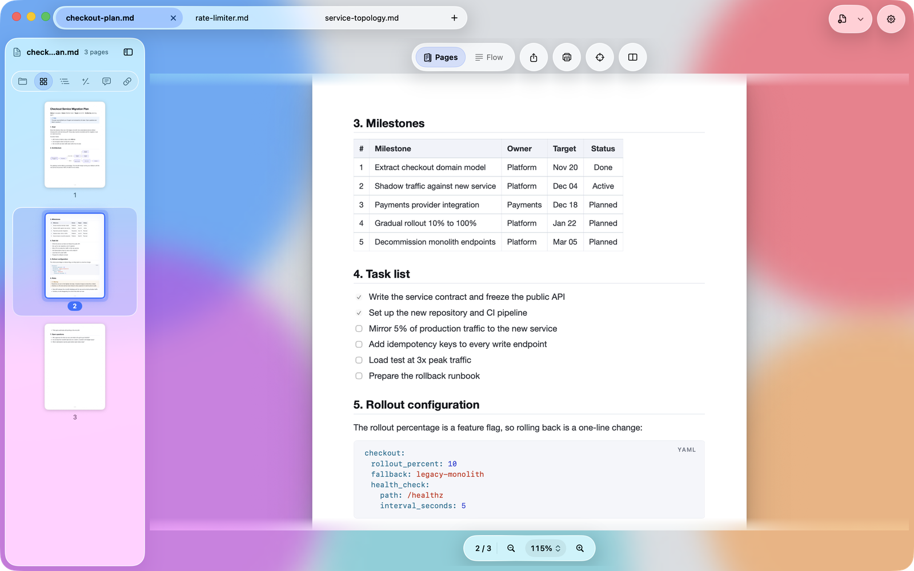
  <br><sub>Pages mode: A4 pages, thumbnails on the left, page counter and zoom at the bottom.</sub>
</p>

#### Flow and Contents

Flow reflows the text to the window width, which is better for long reading and narrow windows. The Contents sidebar lists every heading; click one to jump there. Zoom with **⌘+** and **⌘−**, reset with **⌘0**, and set your default in Settings.

<p align="center">
  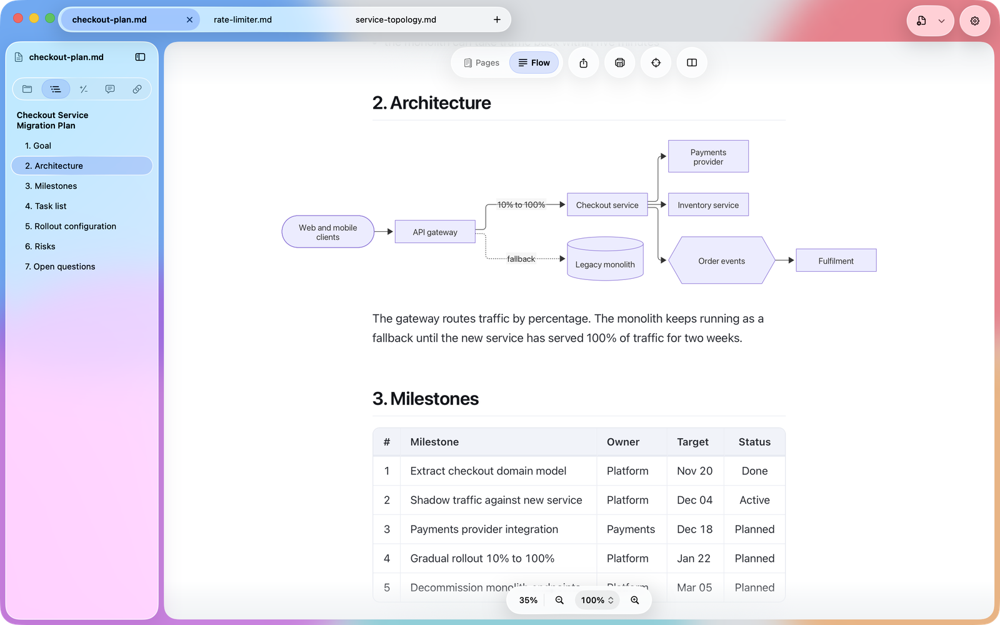
  <br><sub>Flow mode with the Contents sidebar. The current section is highlighted as you read.</sub>
</p>

#### Light and dark

Choose Light, Dark or System from **View ▸ Theme**. Exporting a PDF uses the selected theme; printing uses a light theme by default so that dark-theme documents print legibly (see [Printing](#print-and-export-pdf)).

<p align="center">
  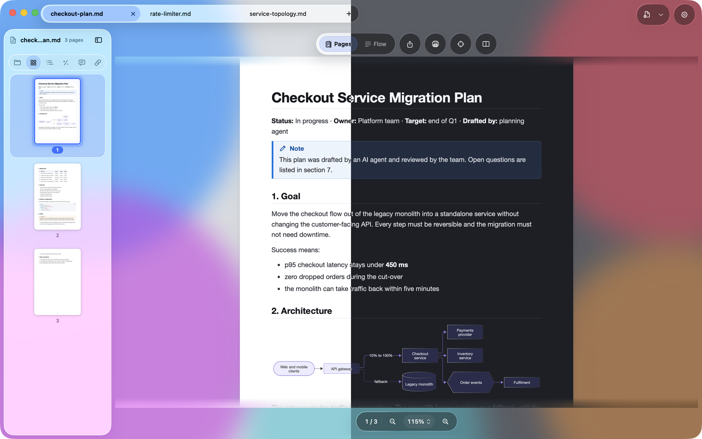
  <br><sub>The same window in the light theme (left) and the dark theme (right).</sub>
</p>

### Rich content

#### Markdown, Mermaid, KaTeX and code

MD Viewer renders GitHub Flavored Markdown (tables, task lists, strikethrough, autolinks), footnotes, alerts such as `> [!NOTE]`, a front matter card, heading anchors, emoji shortcodes, relative images and syntax highlighting for about 190 languages. **Mermaid** diagrams and **KaTeX** math are drawn offline, and they are loaded only when a document actually contains them.

<p align="center">
  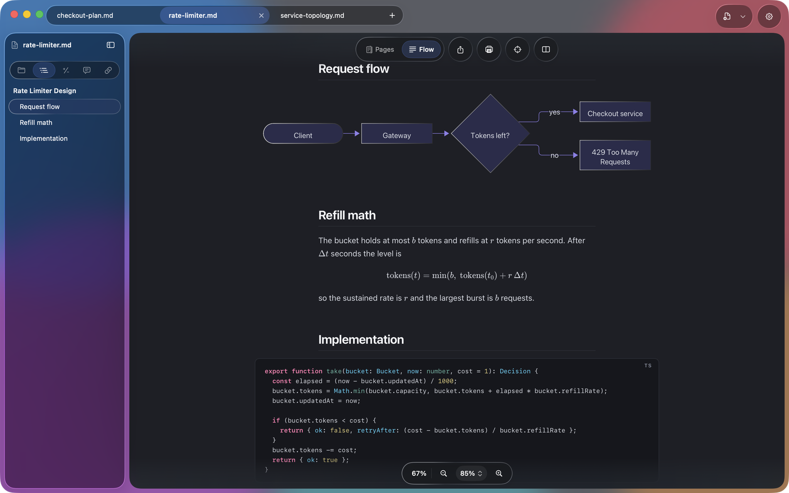
  <br><sub>A Mermaid flowchart, a KaTeX formula and highlighted code in one document (dark theme).</sub>
</p>

#### ASCII diagrams become drawings

AI agents love to sketch architecture with plain-text boxes and arrows. MD Viewer redraws ASCII and Unicode box diagrams as crisp vector graphics: unbroken lines, rounded corners and real arrowheads, in the light or dark theme. In Flow each diagram card has a **Diagram | Text** switch, and in a PDF the diagram text stays selectable and searchable. If the app is not confident that a block is a diagram, it leaves the block exactly as written.

<p align="center">
  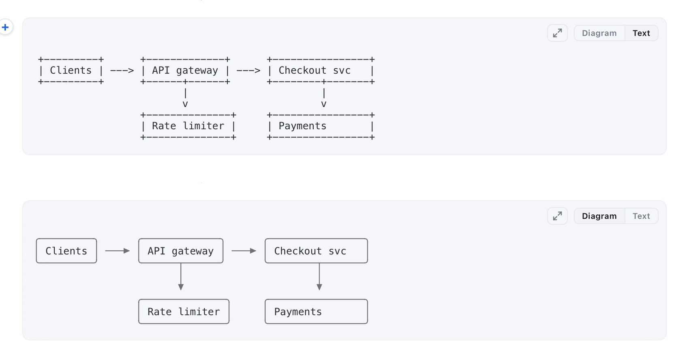
  <br><sub>Top: the original ASCII text (the Text switch). Bottom: the same block redrawn as a diagram.</sub>
</p>

#### Obsidian notes

MD Viewer reads Obsidian's Markdown dialect by default: `[[wikilinks]]` (with labels, headings and block references), `![[embeds]]` of notes, headings, blocks and images, callouts (13 types, foldable, nested), a **Properties** card with tag and alias chips, `#tags`, `==highlights==`, `%%hidden comments%%`, `^block-ids`, custom task states such as `- [/]` and `- [-]`, and Obsidian line breaks. Prefer plain GitHub rendering? Switch to the **GitHub** dialect in Settings and open documents update immediately.

<p align="center">
  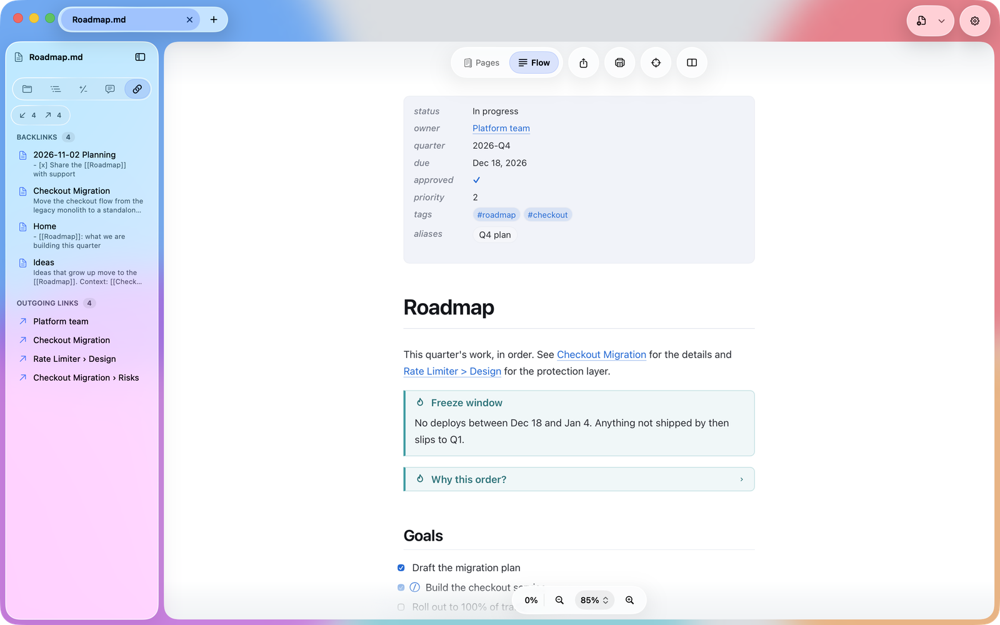
  <br><sub>A note with a Properties card and callouts. On the left, the Links sidebar lists backlinks and outgoing links.</sub>
</p>

<p align="center">
  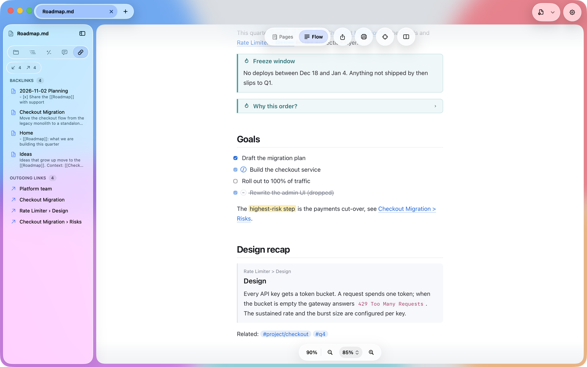
  <br><sub>Further down the same note: custom task states, a ==highlight== and an embedded section.</sub>
</p>

### Workspace

#### Glass tabs and Split View

Documents open in tabs on a glass strip. Put two documents (or the same document twice) side by side with **⌥⌘O**, or drag a tab onto a pane. Scroll syncing (**⌃⌘Y**) keeps both panes on the same heading, so it is easy to compare a translation with the original or a new plan with the old one. Each pane has its own zoom and its own sidebar, mirrored toward the outer edge of the window. Move a tab to its own window with **Window ▸ Move Tab to New Window**, and switch tabs with **⌘1** to **⌘9** or **⇧⌘[** and **⇧⌘]**.

<p align="center">
  
  <br><sub>Tabs on a glass strip.</sub>
</p>

<p align="center">
  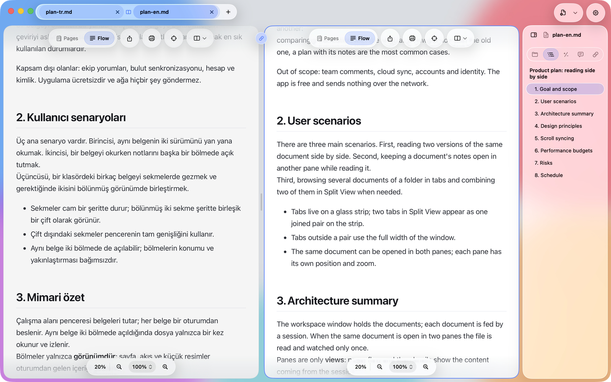
  <br><sub>Split View with scroll syncing: both versions follow the same heading. The sidebar of the active pane sits on the outer edge.</sub>
</p>

#### Folders, vaults, links and tags

**Open Folder…** (**⇧⌘O**) lists the folder's Markdown files in the **Files** sidebar (**⌥⌘3**). The list updates live, and favorite and recent folders are one click away. Click a file for a new tab, **⌥-click** for the right pane, **⌘-click** for a new window.

When you open a note that belongs to an Obsidian vault, MD Viewer offers once to index the folder. The index is kept in memory only and is never written anywhere; you can turn the prompt off in Settings. With the index, the **Links** sidebar (**⌥⌘6**) shows backlinks and outgoing links with context lines, and **Files ▸ Tags** (the **#** button) shows the nested tag tree: a parent tag includes its children.

<p align="center">
  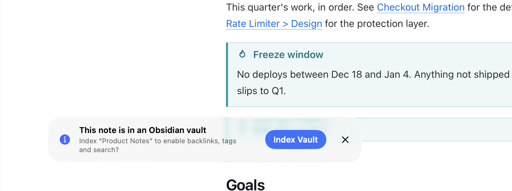
  <br><sub>The one-time prompt when a note lives in an Obsidian vault.</sub>
</p>

<table>
  <tr>
    <td width="50%" align="center">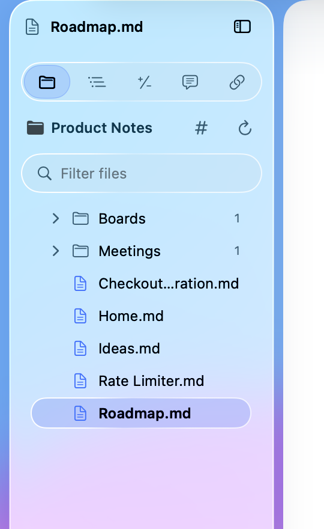<br><sub>Files: the folder's Markdown files and subfolders.</sub></td>
    <td width="50%" align="center">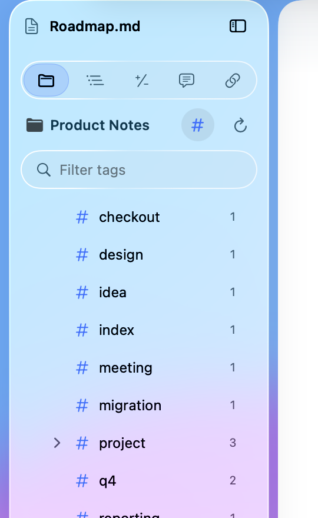<br><sub>Tags: a nested tag tree with note counts.</sub></td>
  </tr>
</table>

#### Quick Switcher, vault search and Find

- **Quick Switcher (⌘K)** finds notes in the vault by fuzzy match, aliases included. With an empty query it lists open tabs and recent documents. **⌘O** stays "Open…".
- **Search in Vault (⇧⌘F)** searches every note: words separated by spaces mean AND, `"exact phrase"`, `-exclude`, `tag:`, `path:` and `file:` filters work, and matching ignores case and accents (including Turkish `ı` and `İ`). Results are grouped by note.
- **Find (⌘F, ⌘G, ⇧⌘G)** searches inside the current document in Flow, Pages and Canvas.

<table>
  <tr>
    <td width="50%" align="center">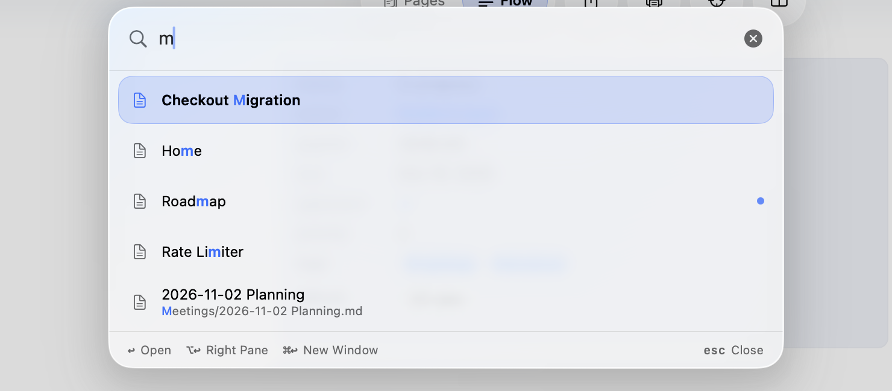<br><sub>Quick Switcher (⌘K).</sub></td>
    <td width="50%" align="center">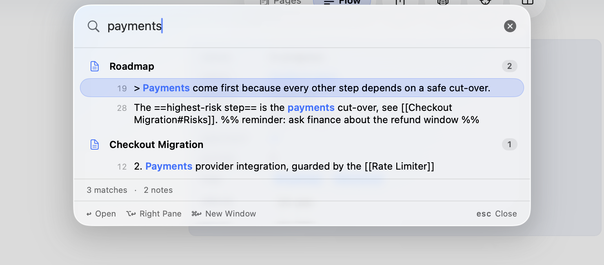<br><sub>Search in Vault (⇧⌘F).</sub></td>
  </tr>
  <tr>
    <td colspan="2" align="center">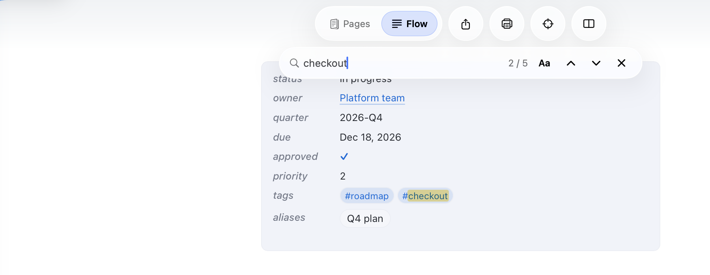<br><sub>Find in the document (⌘F).</sub></td>
  </tr>
</table>

#### Hover preview and Canvas

In Flow, hover over a `[[link]]` for a moment and the target section appears in a small card. Obsidian `.canvas` files open read-only: pan, zoom and fit, with note, file, link and group nodes.

<table>
  <tr>
    <td width="50%" align="center">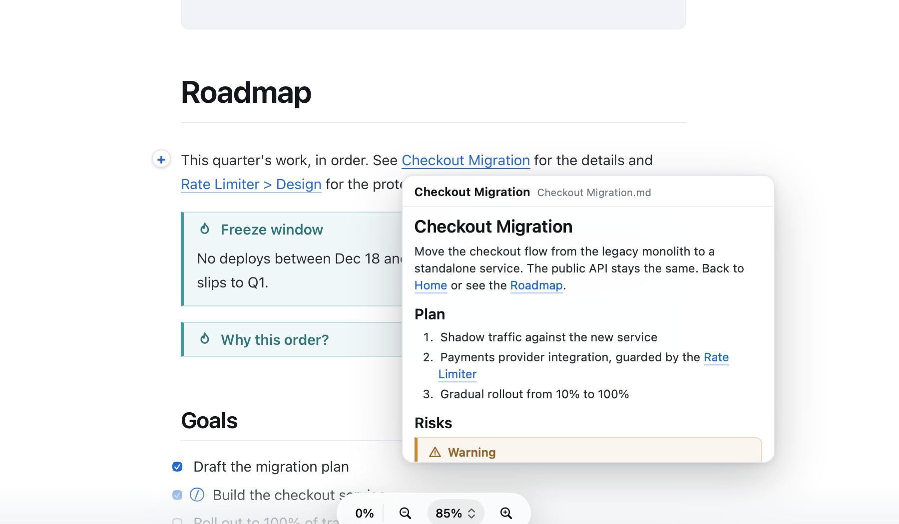<br><sub>Hover preview of a linked note.</sub></td>
    <td width="50%" align="center">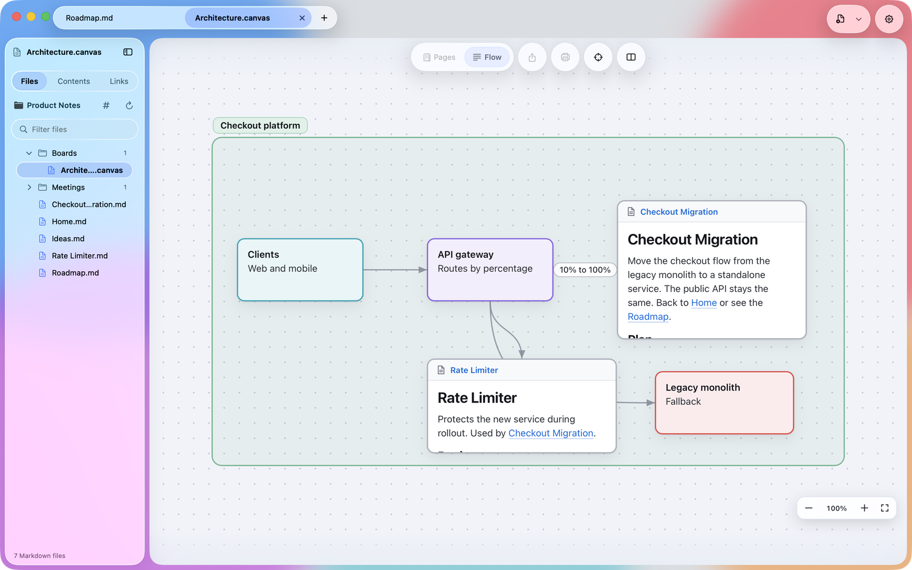<br><sub>A canvas, read-only.</sub></td>
  </tr>
</table>

### For AI agents

#### Live follow

The document refreshes by itself when the file changes, even when an agent saves by replacing the file, and your reading position is kept. Turn on **Follow Changes** (**⇧⌘L**, the target button in the toolbar) and the view scrolls to the part that changed while an agent writes, or to the end of the document if you prefer (**View ▸ Follow Target**). A short notice tells you what following does and whether the file is being written right now. A half-written file is skipped instead of flashing a broken page.

<p align="center">
  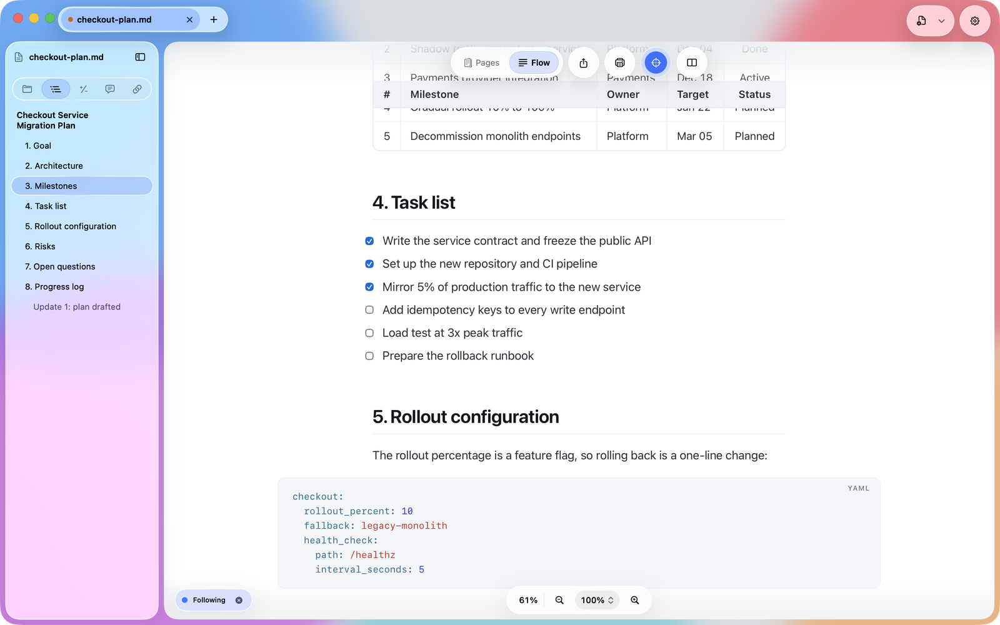
  <br><sub>An agent edits and extends a plan; MD Viewer follows the changed section. (The agent here is a small script.)</sub>
</p>

#### Changes

**Changes** (**⌥⌘4**) keeps the versions of the document you have seen during the session and shows what changed: change bars at the edge in Flow, section badges in Pages, and a line diff in the sidebar with *Mark as Seen*. The history is not saved; it is discarded when you quit.

<p align="center">
  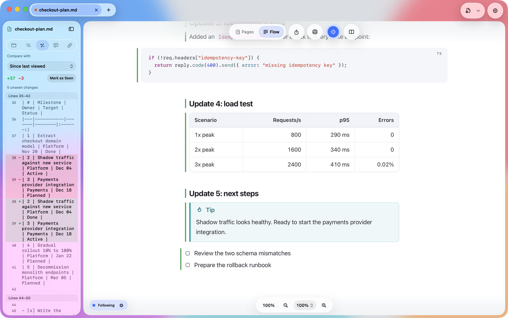
  <br><sub>The Changes sidebar shows removed and added lines; green bars mark the changed blocks.</sub>
</p>

#### Comments and Send to Agent

Select text, or click the **+** beside a block, and press **⇧⌘K** to leave a comment. Comments never touch your document: they are saved in a side file named `<document>.md.review.md` next to it. **Send to Agent** (**⌥⌘P**, or *Edit ▸ Copy Prompt for Agent*) puts all open comments on the clipboard as a formatted prompt with the document path and the quoted passages, ready to paste into your agent.

<table>
  <tr>
    <td width="50%" align="center">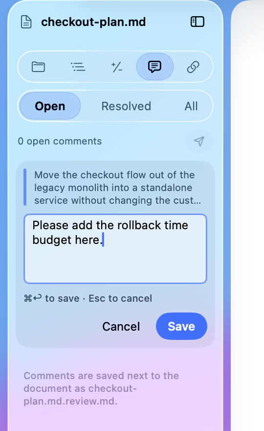<br><sub>Writing a comment (⌘↩ saves).</sub></td>
    <td width="50%" align="center">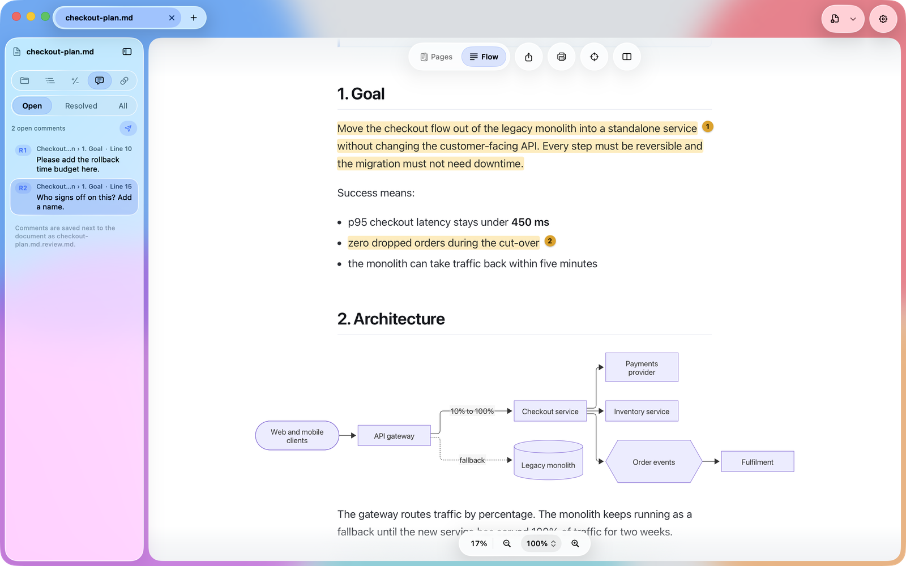<br><sub>Commented passages are highlighted and listed.</sub></td>
  </tr>
</table>

<p align="center">
  
  <br><sub>Send to Agent copies a ready-to-paste prompt.</sub>
</p>

#### Task checkboxes

Click a `- [ ]` checkbox and MD Viewer writes the change to the `.md` file. **⌘Z** undoes it, and if the file changed on disk in the meantime, the click is refused instead of overwriting anything.

<p align="center">
  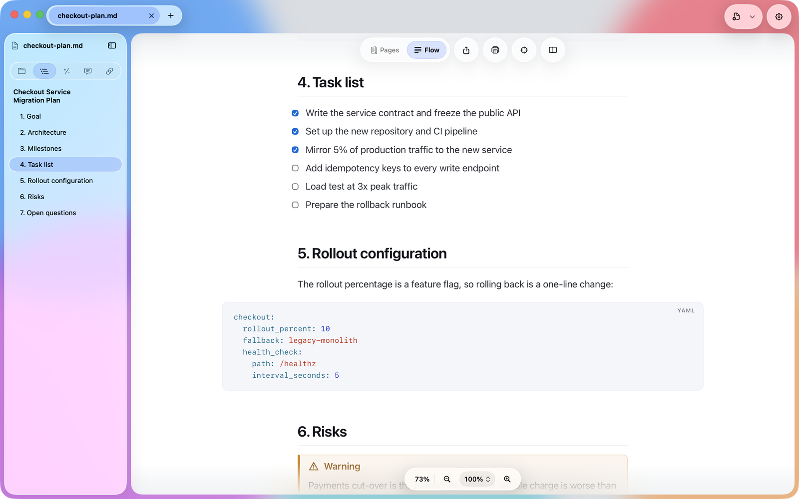
  <br><sub>Tick a task in the viewer; the file on disk is updated.</sub>
</p>

### Output and system

#### Print and export PDF

**Export as PDF** (**⇧⌘E**) saves the document with the selected theme. **Print** (**⌘P**) pages the document for the paper selected in the print panel (A4, or Letter in the US) with a 20 mm margin, and uses the light theme by default: white paper and black text are easier to read and save ink, even if you read in the dark theme. Settings ▸ *Printing and PDF* ▸ *Theme when printing* switches to the selected theme.

<p align="center">
  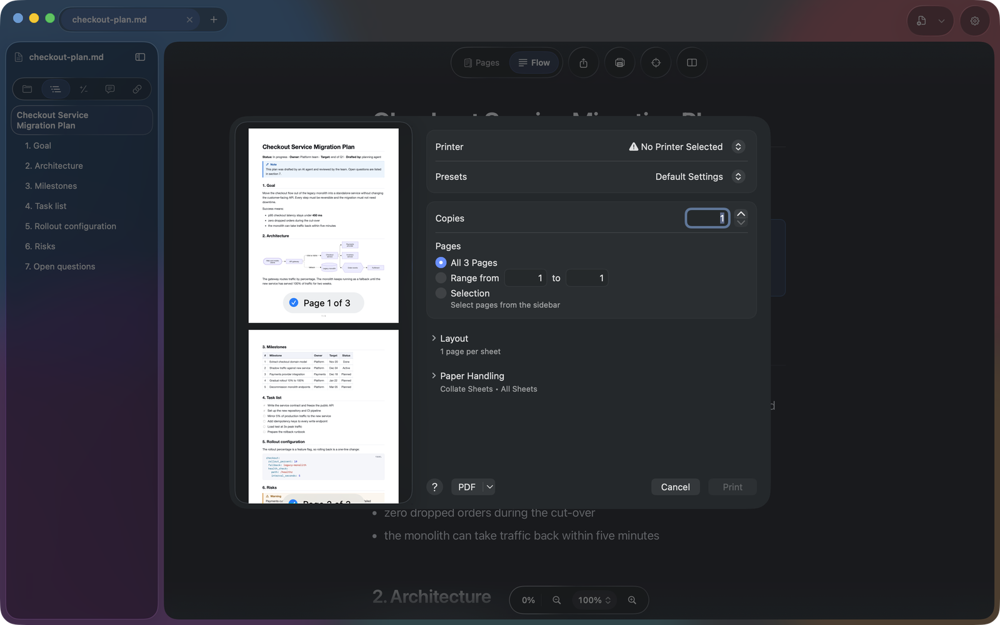
  <br><sub>Print preview: a dark-theme document prints on a light page.</sub>
</p>

#### Quick Look

Press **Space** on a Markdown file in Finder to preview it with the same renderer: Mermaid, KaTeX, code highlighting, the light and dark themes and Obsidian syntax. Quick Look has no vault, so `[[links]]` are not resolved there, images next to the file are not shown, and files over 2 MiB appear as plain text.

#### Settings

Theme, default view and zoom, printing theme, how new documents open (tab or window), follow defaults, Markdown dialect, vault indexing prompt, interface language (System, Türkçe or English; applied after a restart), remote images and the default Markdown app.

<p align="center">
  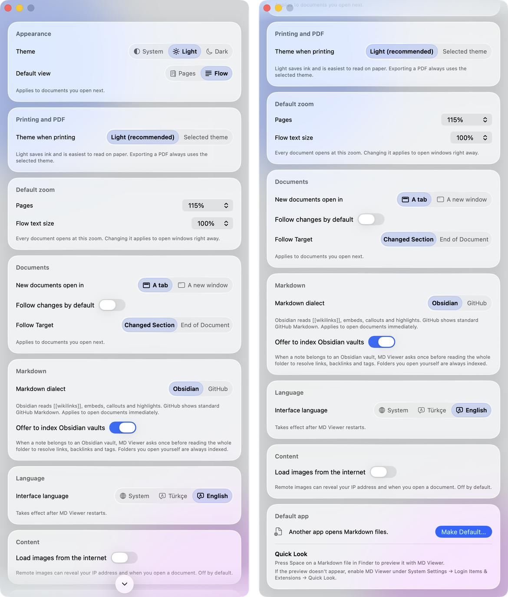
  <br><sub>Settings (the top and the bottom of the window, side by side).</sub>
</p>

## Install

1. [Download the DMG](https://github.com/suleymanozcan/md-viewer/releases/latest/download/MDViewer.dmg) (older versions are on the [Releases page](https://github.com/suleymanozcan/md-viewer/releases)).
2. Open the DMG and drag **MD Viewer** onto the **Applications** shortcut.
3. Open MD Viewer from Applications. The app is signed with a Developer ID and notarized by Apple, so it opens without any right-click workaround. macOS may show the usual "downloaded from the Internet" confirmation the first time.

**Check the download (optional).** Every release lists a SHA-256 checksum next to the DMG. Compare it with the one on your Mac:

```bash
shasum -a 256 ~/Downloads/MDViewer.dmg
```

**Make it your default Markdown viewer.** In the app choose *MD Viewer ▸ Make Default Markdown Viewer…* (or use the button on the welcome window or in Settings). MD Viewer never does this on its own. Alternatively, in Finder select a `.md` file, press **⌘I**, choose MD Viewer under *Open with*, and click *Change All…*.

**Turn on Quick Look.** The preview extension ships inside the app. Copy the app to Applications and open it once. If the preview still does not appear, open System Settings and look for the Quick Look extensions list (on recent macOS versions it is under *Login Items & Extensions*; the exact path differs between macOS versions) and switch on *MD Viewer Quick Look*. If another Markdown Quick Look extension is installed, only one of them can handle `.md` files.

**Mac App Store: coming soon.** MD Viewer is planned for the Mac App Store as "MD Viewer – Markdown Reader". The direct download here stays the main channel.

**Language.** The interface is available in English and Türkçe and follows your system language. Change it under *View ▸ Language* or in Settings.

**Appearance.** On macOS 26 the interface uses Liquid Glass. On macOS 14 and 15 it uses the system's translucent materials.

## Keyboard shortcuts

Every shortcut is also in the menus.

| Shortcut | Action |
|---|---|
| ⌘O · ⇧⌘O | Open… · Open Folder… |
| ⌘K | Quick Switcher… |
| ⇧⌘F | Search in Vault… |
| ⌘F · ⌘G · ⇧⌘G | Find… · Find Next · Find Previous |
| ⇧⌘R | Refresh Folder |
| ⌥⌘O · ⌥⇧⌘O | Open Side by Side… · Open This Document Side by Side |
| ⌘W · ⇧⌘W | Close Tab · Close Window |
| ⌘1 … ⌘8 · ⌘9 | Go to tab 1…8 · Go to the last tab |
| ⇧⌘[ · ⇧⌘] (also ⌃⇧⇥ · ⌃⇥) | Previous tab · Next tab |
| ⌃⌘1 · ⌃⌘2 | Pages view · Flow view |
| ⌥⌘1 … ⌥⌘6 | Sidebar: Thumbnails · Contents · Files · Changes · Comments · Links |
| ⌃⌘S · ⌃⌥⌘S | Hide or show the left sidebar · the right sidebar |
| ⇧⌘L | Follow Changes |
| ⌃⌘X · ⌃⌘Y | Swap Panes · Sync Scrolling |
| ⌥⌘← · ⌥⌘→ | Focus the left pane · the right pane |
| ⌘+ · ⌘− · ⌘0 | Zoom In · Zoom Out · Reset to Default Zoom (see the [FAQ](#faq) for Turkish keyboards) |
| ⌃⌘0 · ⌥⌘0 · ⌥⌘9 | Actual Size · Fit Width · Fit Page |
| ⇧⌘K | Add Comment… |
| ⌥⌘P | Send to Agent (Copy Prompt for Agent) |
| ⇧⌘E · ⌘P | Export as PDF… · Print… |
| ⌘R · ⌃⌘F | Reload · Enter Full Screen |
| ⌘, | Settings |

## Privacy

MD Viewer collects no data, has no accounts, analytics or tracking, and makes no network connections. Remote images are off by default; if you turn them on, the image servers see your IP address like any website would. The only things the app ever writes into your files are a task checkbox you click and the `.review.md` comment side file. Read the full policy in [PRIVACY.md](PRIVACY.md) (English and Türkçe).

## FAQ

**The zoom shortcuts do not work on my Turkish keyboard.**
On the Turkish PC layout, `+` is on Shift+4 and `=` on Shift+0, which collide with system shortcuts such as ⌘⇧4. MD Viewer reads the character the key produces: press **⌘ and the `*` key** (the key to the right of 0, without Shift) or **⌘ and `+` on the numeric keypad** to zoom in, and **⌘ and `-`** (or keypad `-`) to zoom out. On a US layout, ⌘+ and ⌘= both work. In Split View zoom applies to the active pane.

**How do I turn off Obsidian syntax?**
Open Settings ▸ *Markdown* ▸ *Markdown dialect* and choose **GitHub**. Open documents re-render at once. There is no automatic detection: by default every document is read with Obsidian syntax. To stop the vault indexing prompt, switch off *Offer to index Obsidian vaults* in the same section.

**Why are the images from the internet missing?**
Remote images are off by default, because loading them reveals your IP address and when you open the document. Turn them on in Settings ▸ *Content* ▸ *Load images from the internet*.

**Why does printing use a light theme when I read in dark?**
White paper with black text reads better and saves ink. Change it in Settings ▸ *Printing and PDF* ▸ *Theme when printing*. Exporting to PDF always uses the theme you have selected.

**The Quick Look preview does not show up.**
See [Install](#install). Open the app once from Applications and check the Quick Look extensions list in System Settings. If it still does not appear, run `qlmanage -r` in Terminal to reset the Quick Look cache.

**Does MD Viewer edit my files?**
Only in two cases: when you click a task checkbox (the `.md` file is updated; ⌘Z undoes it), and when you add comments (saved in a separate `<name>.md.review.md` file; the document itself is not changed). Everything else is read-only.

**Where are my comments stored?**
Next to the document, in `<name>.md.review.md`. It is plain Markdown. Keep it with the document or delete it when you are done.

**Does MD Viewer check for updates?**
No. Download new versions from the [Releases page](https://github.com/suleymanozcan/md-viewer/releases). The [changelog](CHANGELOG.md) lists what changed.

## Feedback

Found a bug or have an idea? [Open an issue](https://github.com/suleymanozcan/md-viewer/issues/new/choose); the form asks for your macOS version, the MD Viewer version and a small Markdown sample. Please do not attach private documents. You can also write to [hello@minata.dev](mailto:hello@minata.dev). More in [SUPPORT.md](SUPPORT.md) and the [usage guide](docs/USAGE.md).

## About

MD Viewer is developed by **Minata Entertainment, LLC**, a studio in Antalya, Türkiye, registered as a limited liability company in Delaware, United States. The studio takes products from the first idea to the release build (architecture, backend, client, store listing) and stays with them after launch.

[minata.dev](https://minata.dev/en/) · [hello@minata.dev](mailto:hello@minata.dev)

## License

MD Viewer is free to use, including for commercial work, and you may redistribute the unmodified DMG. It is closed-source software provided without warranty. See [LICENSE](LICENSE). The libraries bundled in the app keep their own licenses, listed in [THIRD_PARTY_NOTICES.md](THIRD_PARTY_NOTICES.md).

© 2026 Minata Entertainment, LLC
