<p align="center">
  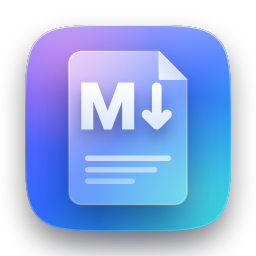
</p>

<h1 align="center">MD Viewer</h1>

<p align="center">
  <b>macOS için ücretsiz, yerel bir Markdown görüntüleyici: yapay zekâ ajanlarının yazdığı planlar ve Obsidian kasaları için.</b>
</p>

<p align="center">
  <a href="README.md">English</a> | Türkçe
</p>

<p align="center">
  <a href="https://github.com/suleymanozcan/md-viewer/releases/latest/download/MDViewer.dmg"><b>⬇&nbsp; MD Viewer'ı macOS için indir</b></a>
</p>

<p align="center">
  
  
  
  
</p>

<p align="center">
  macOS 14 ve üzeri · Apple silikon ve Intel · Developer ID ile imzalı, Apple tarafından notarize edilmiş · Ücretsiz, hesapsız, çevrimdışı çalışır
</p>

<p align="center">
  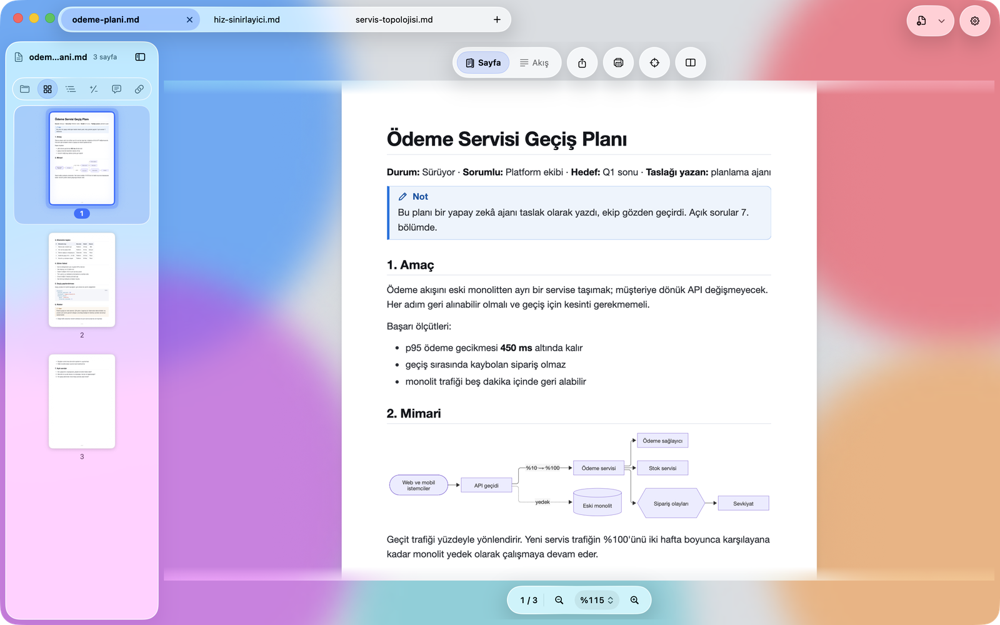
</p>

<p align="center">
  <a href="#neden-md-viewer">Neden</a> ·
  <a href="#özellikler">Özellikler</a> ·
  <a href="#kurulum">Kurulum</a> ·
  <a href="#klavye-kısayolları">Kısayollar</a> ·
  <a href="#sık-sorulan-sorular">SSS</a> ·
  <a href="docs/USAGE.tr.md">Kullanım kılavuzu</a> ·
  <a href="CHANGELOG.md">Değişiklik günlüğü</a>
</p>

## Neden MD Viewer

- **Ajanların yazdığını, yazılırken okuyun.** Yapay zekâ kodlama ajanlarının planları, şartnameleri ve mimari notları Markdown'dır. MD Viewer ajan dosyayı düzenlerken onu takip eder, neyin değiştiğini gösterir, herhangi bir pasaja yorum bırakmanızı sağlar ve bu yorumları ajana hazır bir istem olarak geri verir.
- **Obsidian kasaları için.** Herhangi bir notu ya da klasörü açın; Obsidian'ı başlatmadan wikilink, gömü, callout, özellik kartı, geri bağlantı, etiket, hızlı geçiş, kasada arama ve canvas'ları alın.
- **Hafif ve yerel.** SwiftUI ile yazılmış yerel bir uygulama; indirme boyutu yaklaşık 13 MB, Electron yok, hesap yok. Mermaid, KaTeX ve gerisi uygulamanın içinde olduğundan ağ bağlantısı kurmaz.
- **Ücretsiz.** Reklam yok, telemetri yok, abonelik yok. Belgeleriniz Mac'inizde kalır. Bkz. [PRIVACY.md](PRIVACY.md).

## Özellikler

### Okuma

#### Sayfa modu ve küçük resimler

Sayfa modu belgenizi Önizleme'deki gibi A4 sayfalar olarak dizer; solda sayfa küçük resimleri ve tıklanabilir bir İçindekiler listesi bulunur. Başlıklar ve küçük bloklar sayfalar arasında bölünmez; yüksek bir tablo sonraki sayfada başlık satırı tekrarlanarak devam eder. Sayfa ile Akış arasında **⌃⌘1** ve **⌃⌘2** ile geçin; Küçük Resimler **⌥⌘1**, İçindekiler **⌥⌘2** ile açılır.

<p align="center">
  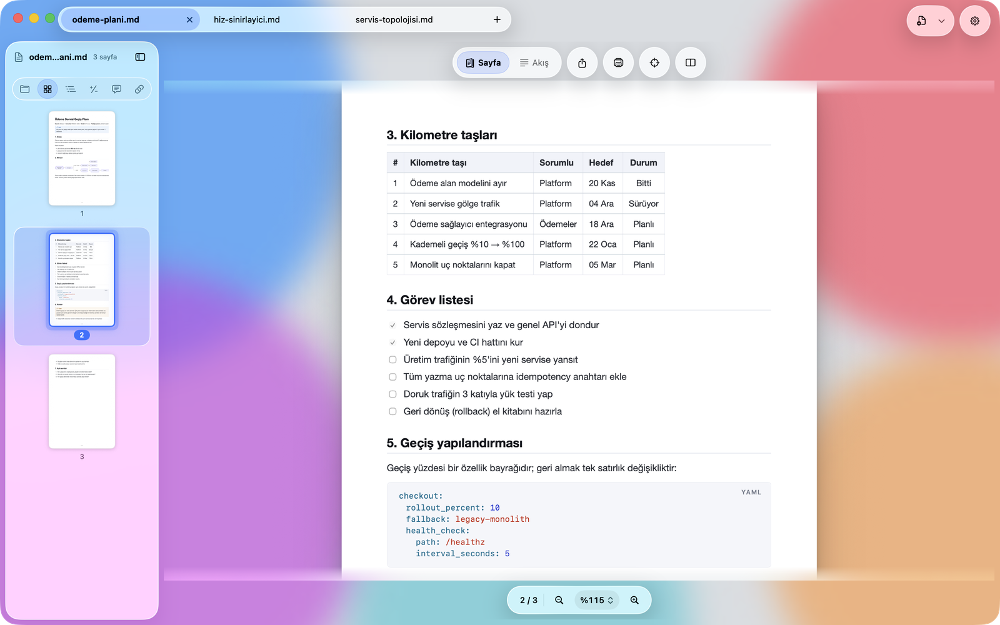
  <br><sub>Sayfa modu: A4 sayfalar, solda küçük resimler, altta sayfa sayacı ve yakınlaştırma.</sub>
</p>

#### Akış modu ve İçindekiler

Akış, metni pencere genişliğine göre yeniden akıtır; uzun okumalar ve dar pencereler için daha rahattır. İçindekiler kenar çubuğu tüm başlıkları listeler; birine tıklayınca oraya gidilir. **⌘+** ve **⌘−** ile yakınlaştırın, **⌘0** ile sıfırlayın; varsayılanı Ayarlar'dan seçebilirsiniz.

<p align="center">
  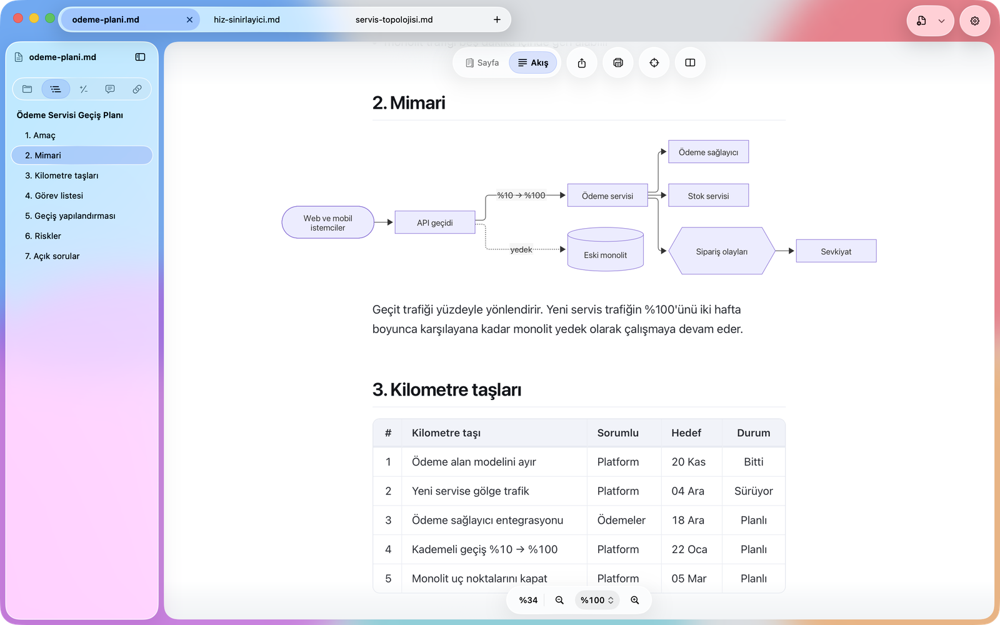
  <br><sub>İçindekiler kenar çubuğuyla Akış modu. Okudukça geçerli bölüm vurgulanır.</sub>
</p>

#### Açık ve koyu tema

**Görünüm ▸ Tema** menüsünden Açık, Koyu ya da Sistem'i seçin. PDF'e aktarma seçili temayı kullanır; yazdırma ise koyu temada okunan belgeler de okunaklı çıksın diye varsayılan olarak açık temayı kullanır (bkz. [Yazdırma](#yazdırma-ve-pdf-olarak-dışa-aktarma)).

<p align="center">
  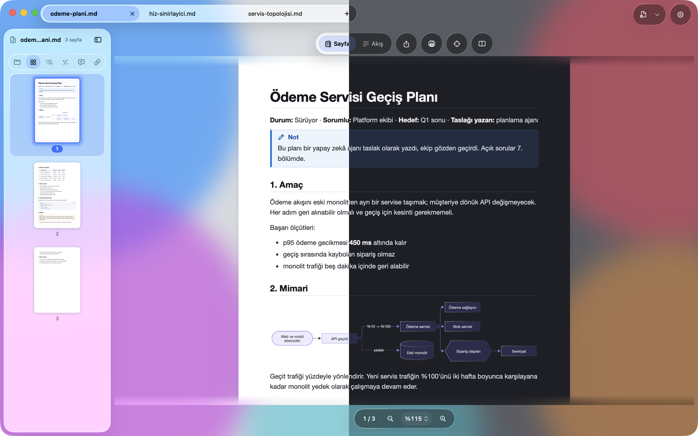
  <br><sub>Aynı pencere açık (solda) ve koyu (sağda) temada.</sub>
</p>

### Zengin içerik

#### Markdown, Mermaid, KaTeX ve kod

MD Viewer GitHub Flavored Markdown'ı (tablo, görev listesi, üstü çizili, otomatik bağlantı), dipnotları, `> [!NOTE]` gibi uyarı kutularını, front matter kartını, başlık çapalarını, emoji kısa kodlarını, göreli resimleri ve yaklaşık 190 dil için kod vurgulamayı gösterir. **Mermaid** diyagramları ve **KaTeX** formülleri çevrimdışı çizilir ve yalnızca belgede varsa yüklenir.

<p align="center">
  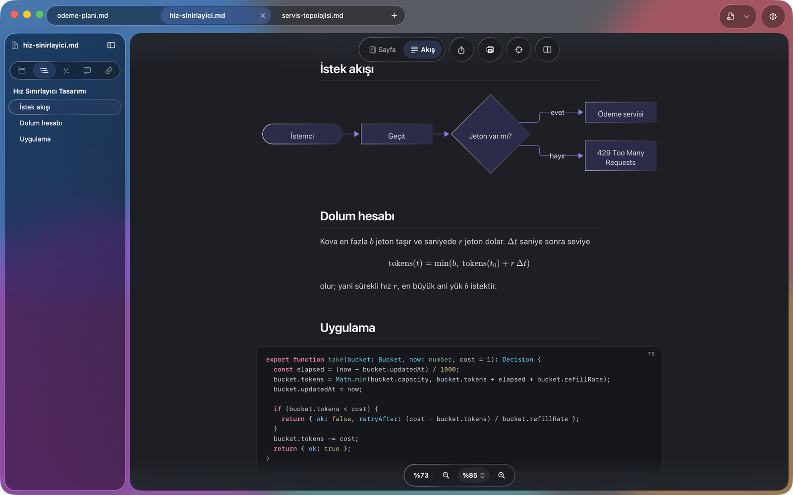
  <br><sub>Tek belgede Mermaid akış şeması, KaTeX formülü ve vurgulanmış kod (koyu tema).</sub>
</p>

#### ASCII diyagramlar çizime dönüşür

Yapay zekâ ajanları mimariyi düz metinle kutular ve oklarla çizmeyi sever. MD Viewer ASCII ve Unicode kutu diyagramlarını net bir vektör çizim olarak yeniden çizer: kesintisiz çizgiler, yuvarlak köşeler, gerçek ok uçları; açık ve koyu temaya uyar. Akış'ta her diyagram kartında bir **Diyagram | Metin** anahtarı bulunur; PDF'te diyagramın metni seçilebilir ve aranabilir kalır. Uygulama bir bloğun diyagram olduğundan emin değilse bloğa dokunmaz, olduğu gibi bırakır.

<p align="center">
  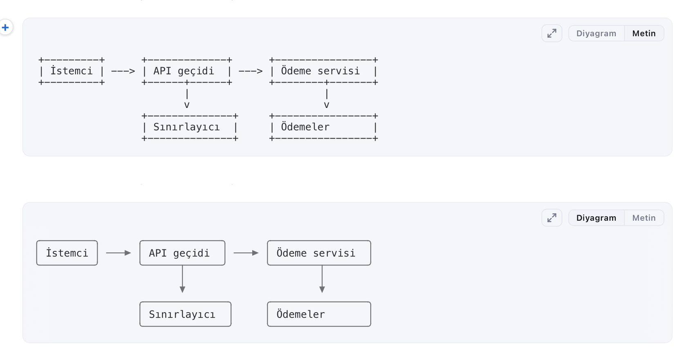
  <br><sub>Üstte: özgün ASCII metin (Metin anahtarı). Altta: aynı blok diyagram olarak yeniden çizilmiş.</sub>
</p>

#### Obsidian notları

MD Viewer varsayılan olarak Obsidian'ın Markdown lehçesini okur: `[[wikilink]]` (etiketli, başlıklı ve blok başvurulu), not, başlık, blok ve görsel `![[gömüleri]]`, callout'lar (13 tür, katlanabilir, iç içe), etiket ve takma ad çipli **Özellikler** kartı, `#etiket`, `==vurgu==`, `%%gizli yorum%%`, `^blok-kimliği`, `- [/]` ve `- [-]` gibi özel görev durumları ve Obsidian satır sonları. Düz GitHub görünümünü mü tercih edersiniz? Ayarlar'da **GitHub** lehçesine geçin; açık belgeler anında güncellenir.

<p align="center">
  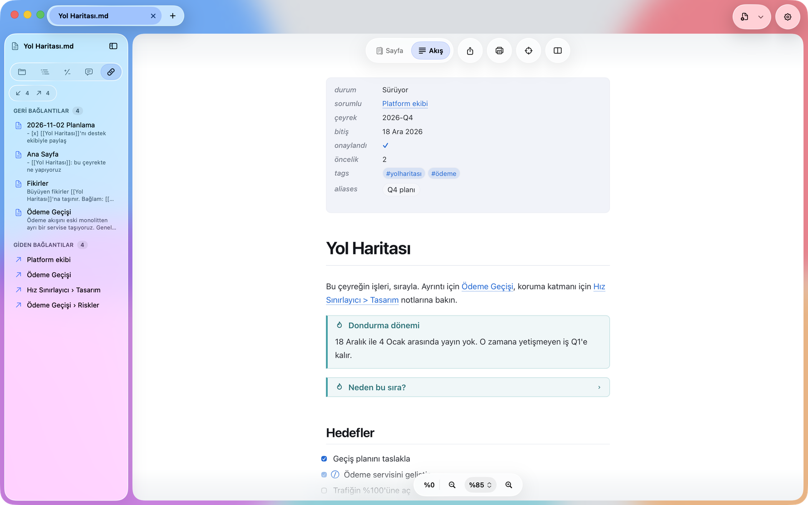
  <br><sub>Özellikler kartı ve callout'lu bir not. Solda, Bağlantılar kenar çubuğu geri bağlantıları ve giden bağlantıları listeler.</sub>
</p>

<p align="center">
  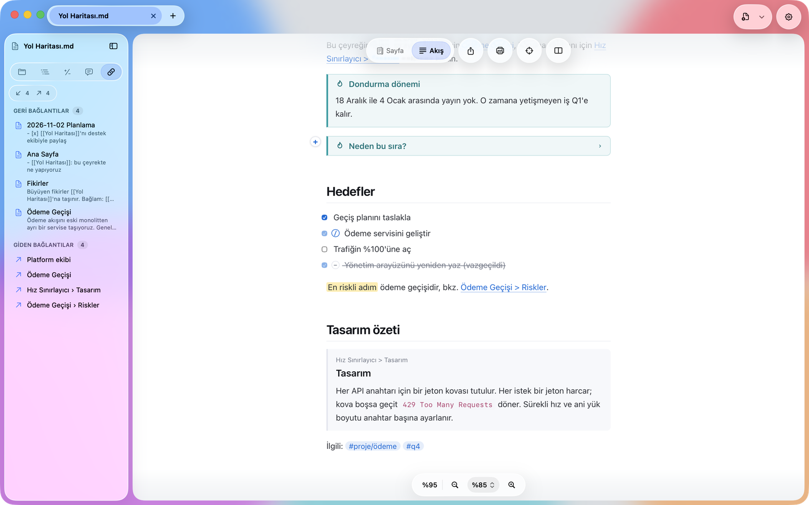
  <br><sub>Aynı notun devamı: özel görev durumları, bir ==vurgu== ve gömülü bir bölüm.</sub>
</p>

### Çalışma alanı

#### Cam sekmeler ve bölünmüş görünüm

Belgeler cam bir şeritte sekmeler olarak açılır. İki belgeyi (ya da aynı belgeyi iki kez) **⌥⌘O** ile yan yana koyun ya da bir sekmeyi bölmenin üzerine sürükleyin. Kaydırma eşitleme (**⌃⌘Y**) iki bölmeyi aynı başlıkta tutar; çeviriyi aslıyla ya da yeni planı eskisiyle karşılaştırmak kolaylaşır. Her bölmenin kendi yakınlaştırması ve kendi kenar çubuğu vardır; kenar çubukları pencerenin dış kenarına doğru yansıtılır. Bir sekmeyi **Pencere ▸ Sekmeyi Yeni Pencereye Taşı** ile ayrı pencereye alın; sekmeler arasında **⌘1** ile **⌘9** ya da **⇧⌘[** ve **⇧⌘]** ile geçin.

<p align="center">
  
  <br><sub>Cam şeritte sekmeler.</sub>
</p>

<p align="center">
  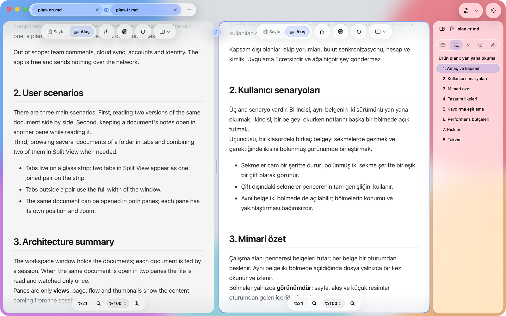
  <br><sub>Kaydırma eşitlemeli bölünmüş görünüm: iki sürüm aynı başlığı izler. Etkin bölmenin kenar çubuğu dış kenarda durur.</sub>
</p>

#### Klasörler, kasalar, bağlantılar ve etiketler

**Klasör Aç…** (**⇧⌘O**) bir klasörün Markdown dosyalarını **Dosyalar** kenar çubuğunda (**⌥⌘3**) listeler. Liste canlı güncellenir; favori ve son klasörler tek tıkla açılır. Bir dosyaya tıklayınca yeni sekme açılır; **⌥-tık** sağ bölmede, **⌘-tık** yeni pencerede açar.

Bir Obsidian kasasındaki bir notu açtığınızda MD Viewer klasörü dizinlemeyi bir kez önerir. Dizin yalnızca bellekte tutulur, hiçbir yere yazılmaz; öneriyi Ayarlar'dan kapatabilirsiniz. Dizinle birlikte **Bağlantılar** kenar çubuğu (**⌥⌘6**) geri ve giden bağlantıları bağlam satırlarıyla gösterir; **Dosyalar ▸ Etiketler** (**#** düğmesi) iç içe etiket ağacını gösterir: üst etiket alt etiketlerini kapsar.

<p align="center">
  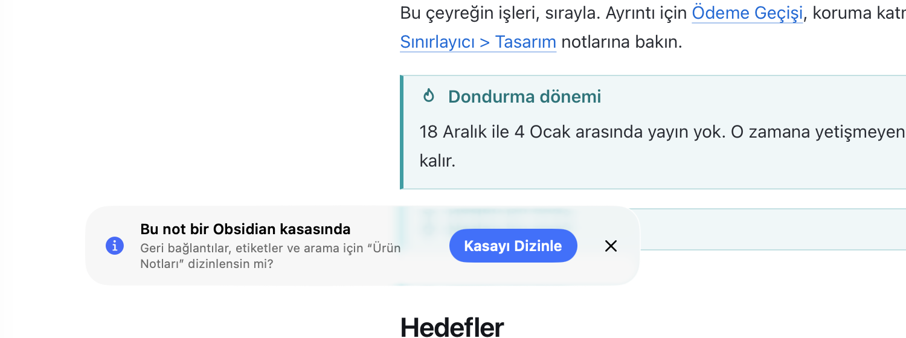
  <br><sub>Bir not Obsidian kasasındaysa çıkan tek seferlik öneri.</sub>
</p>

<table>
  <tr>
    <td width="50%" align="center">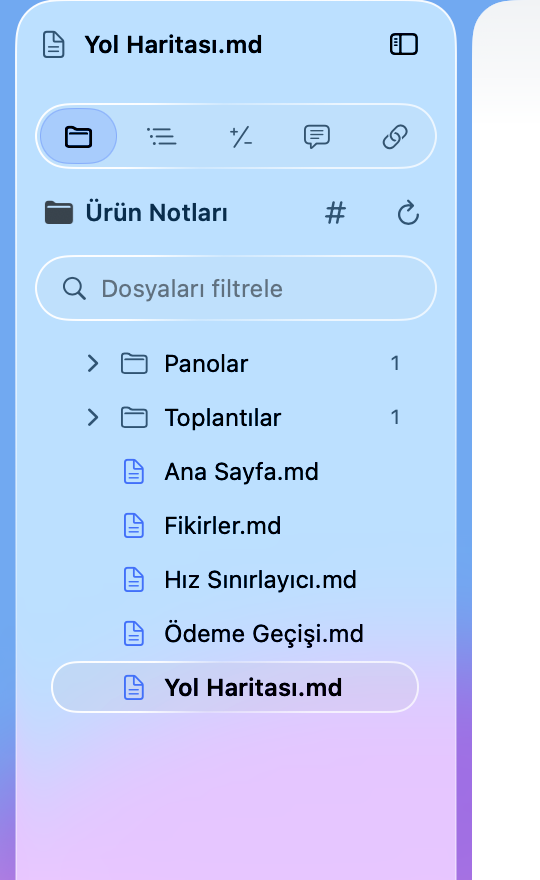<br><sub>Dosyalar: klasörün Markdown dosyaları ve alt klasörleri.</sub></td>
    <td width="50%" align="center">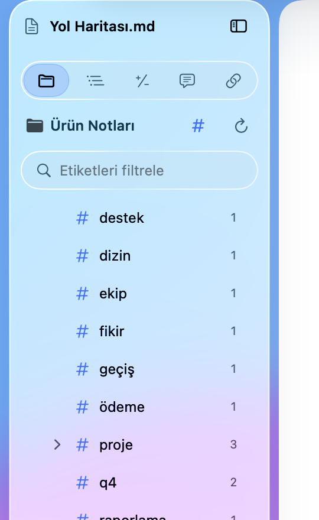<br><sub>Etiketler: not sayılarıyla iç içe etiket ağacı.</sub></td>
  </tr>
</table>

#### Hızlı Geçiş, kasada arama ve Bul

- **Hızlı Geçiş (⌘K)** kasadaki notları bulanık eşleşmeyle bulur; takma adlar dahildir. Sorgu boşken açık sekmeleri ve son belgeleri listeler. **⌘O** "Aç…" olarak kalır.
- **Kasada Ara (⇧⌘F)** tüm notlarda arar: boşlukla ayrılan sözcükler VE anlamına gelir; `"tam ifade"`, `-hariç`, `tag:`, `path:` ve `file:` süzgeçleri çalışır; eşleşme büyük/küçük harf ve aksan duyarsızdır (Türkçe `ı` ve `İ` dahil). Sonuçlar not başına gruplanır.
- **Bul (⌘F, ⌘G, ⇧⌘G)** geçerli belgede Akış, Sayfa ve Canvas'ta arar.

<table>
  <tr>
    <td width="50%" align="center">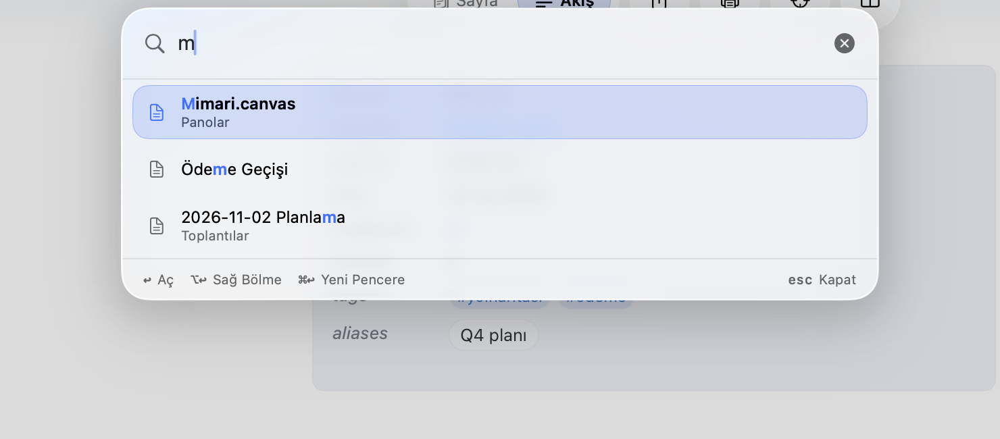<br><sub>Hızlı Geçiş (⌘K).</sub></td>
    <td width="50%" align="center">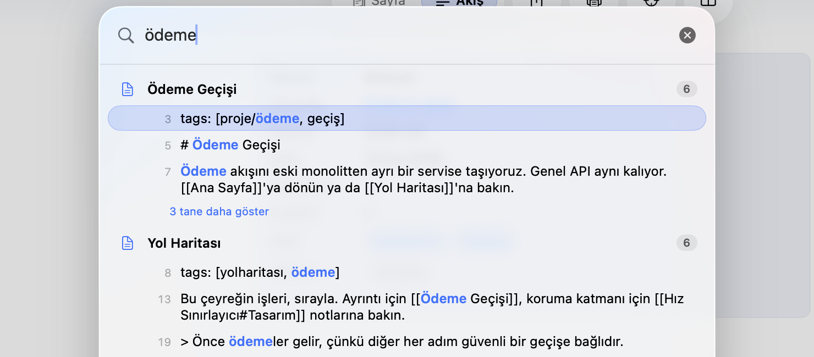<br><sub>Kasada Ara (⇧⌘F).</sub></td>
  </tr>
  <tr>
    <td colspan="2" align="center">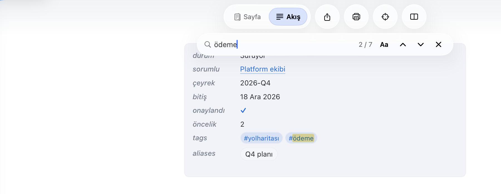<br><sub>Belgede Bul (⌘F).</sub></td>
  </tr>
</table>

#### Üzerine gelince önizleme ve Canvas

Akış'ta bir `[[bağlantı]]` üzerinde kısa bir süre bekleyin; hedef notun ilgili bölümü küçük bir kartta görünür. Obsidian `.canvas` dosyaları salt okunur açılır: kaydırma, yakınlaştırma ve sığdırma; not, dosya, bağlantı ve grup düğümleri desteklenir.

<table>
  <tr>
    <td width="50%" align="center">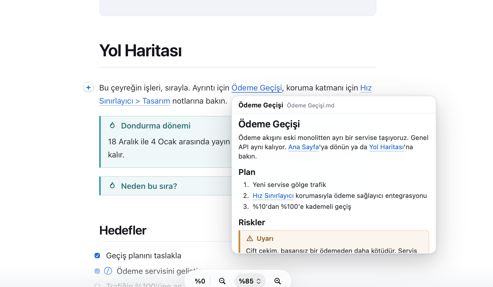<br><sub>Bağlı notun üzerine gelince önizleme.</sub></td>
    <td width="50%" align="center">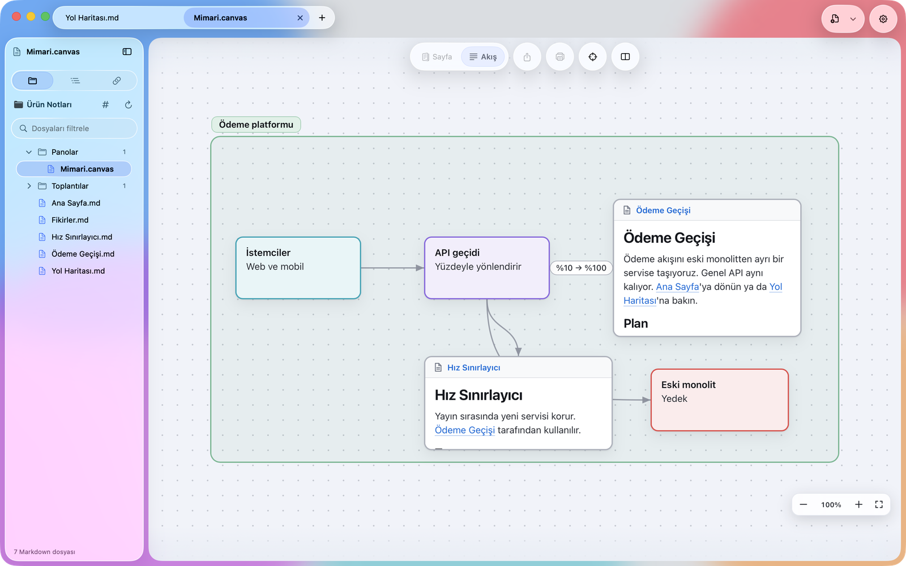<br><sub>Salt okunur bir canvas.</sub></td>
  </tr>
</table>

### Yapay zekâ ajanları için

#### Canlı takip

Dosya değiştiğinde belge kendiliğinden yenilenir; ajan dosyayı üzerine yazarak kaydetse bile okuma konumunuz korunur. **Değişiklikleri Takip Et**'i açın (**⇧⌘L**, araç çubuğundaki hedef düğmesi); ajan yazarken görünüm değişen bölüme, isterseniz belge sonuna kayar (**Görünüm ▸ Takip Hedefi**). Kısa bir bildirim takibin ne yaptığını ve dosyanın şu an yazılıp yazılmadığını söyler. Yarım yazılmış dosya, bozuk bir sayfa göstermek yerine atlanır.

<p align="center">
  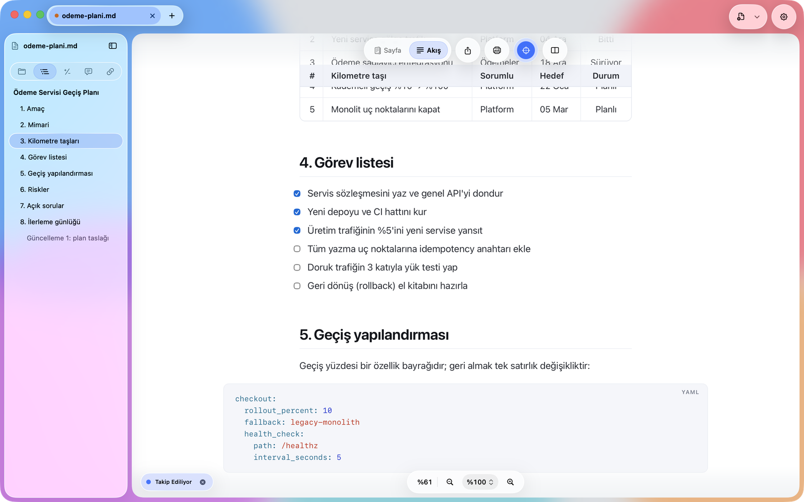
  <br><sub>Bir ajan planı düzenler ve uzatır; MD Viewer değişen bölümü izler. (Buradaki ajan küçük bir betiktir.)</sub>
</p>

#### Değişiklikler

**Değişiklikler** (**⌥⌘4**) oturum boyunca gördüğünüz belge sürümlerini tutar ve neyin değiştiğini gösterir: Akış'ta kenarda değişiklik çubukları, Sayfa'da bölüm rozetleri, kenar çubuğunda *Gördüm Olarak İşaretle* ile satır farkı. Geçmiş kaydedilmez; uygulamadan çıkınca silinir.

<p align="center">
  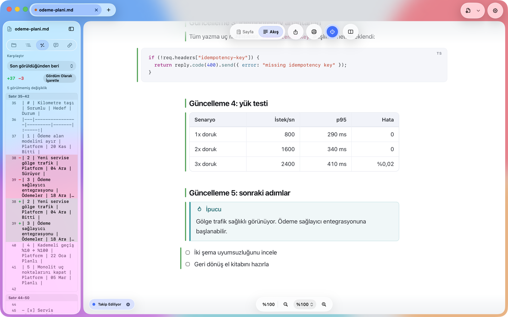
  <br><sub>Değişiklikler kenar çubuğu silinen ve eklenen satırları gösterir; yeşil çubuklar değişen blokları işaretler.</sub>
</p>

#### Yorumlar ve Ajana Gönder

Metni seçin ya da bir bloğun yanındaki **+** işaretine tıklayın ve yorum eklemek için **⇧⌘K**'ya basın. Yorumlar belgenize **dokunmaz**: yanındaki `<belge>.md.review.md` adlı bir yan dosyada saklanır. **Ajana Gönder** (**⌥⌘P** ya da *Düzen ▸ Ajan İçin İstemi Kopyala*) açık yorumların hepsini belge yolu ve alıntılarla biçimli bir istem olarak panoya koyar; ajanınıza yapıştırmanız yeter.

<table>
  <tr>
    <td width="50%" align="center">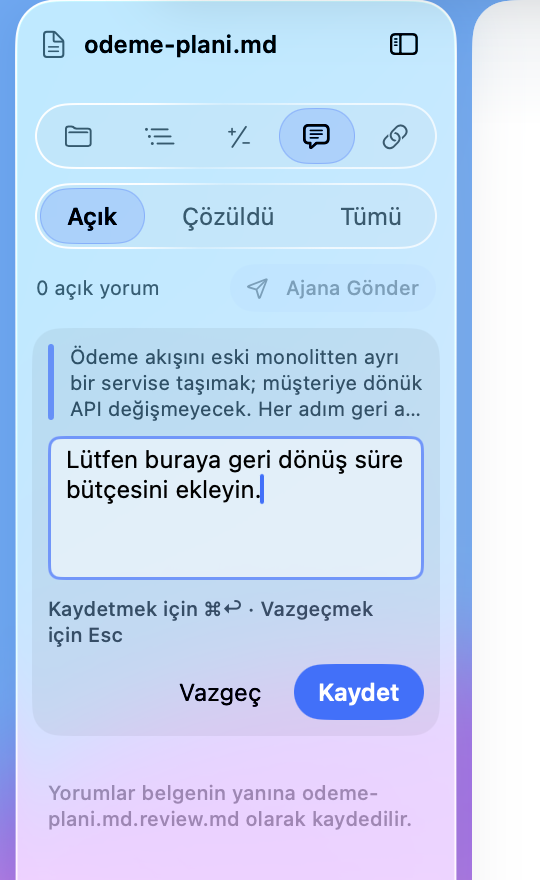<br><sub>Yorum yazmak (⌘↩ kaydeder).</sub></td>
    <td width="50%" align="center">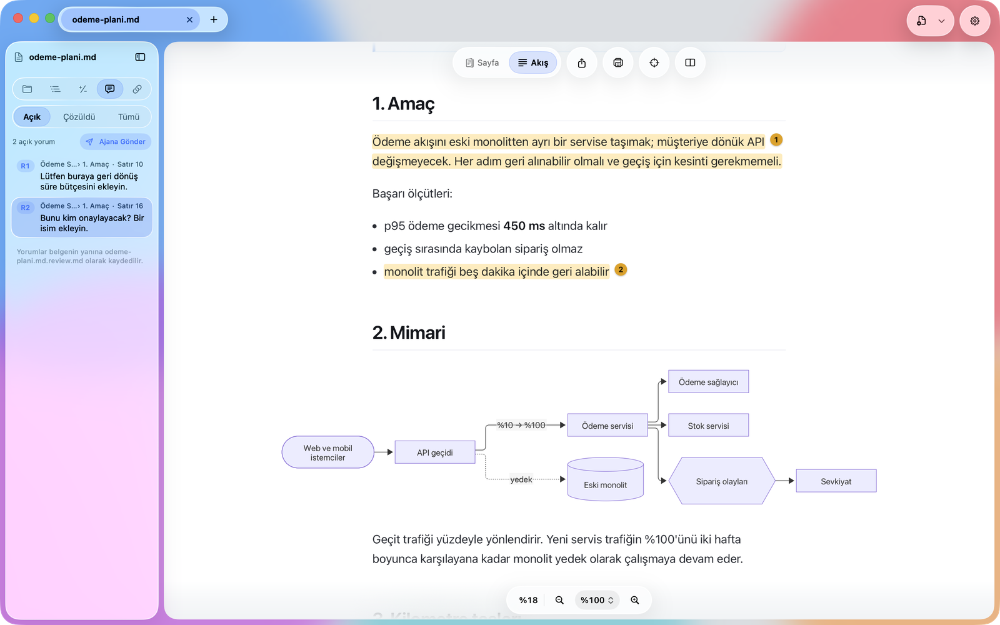<br><sub>Yorumlu pasajlar vurgulanır ve listelenir.</sub></td>
  </tr>
</table>

<p align="center">
  
  <br><sub>Ajana Gönder, yapıştırmaya hazır bir istem kopyalar.</sub>
</p>

#### Görev kutusu tıklama

Bir `- [ ]` kutusuna tıklayın; MD Viewer değişikliği `.md` dosyasına yazar. **⌘Z** geri alır; bu arada dosya diskte değiştiyse hiçbir şeyin üzerine yazmak yerine tıklama reddedilir.

<p align="center">
  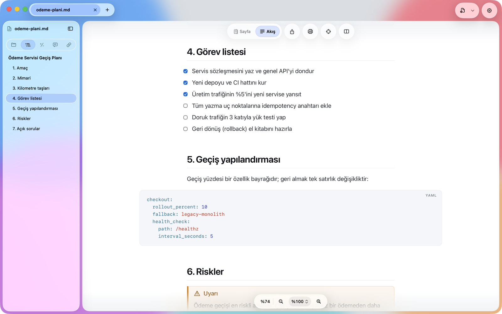
  <br><sub>Görüntüleyicide bir görevi işaretleyin; diskteki dosya güncellenir.</sub>
</p>

### Çıktı ve sistem

#### Yazdırma ve PDF olarak dışa aktarma

**PDF Olarak Dışa Aktar** (**⇧⌘E**) belgeyi seçili temayla kaydeder. **Yazdır** (**⌘P**) belgeyi yazdırma panelinde seçili kâğıda göre (A4, ABD'de Letter) 20 mm kenar boşluğuyla sayfalar ve varsayılan olarak açık temayı kullanır: beyaz kâğıt ve siyah metin, siz koyu temada okusanız bile daha okunaklıdır ve mürekkep tasarrufu sağlar. Ayarlar ▸ *Yazdırma ve PDF* ▸ *Yazdırırken tema* ile seçili temaya geçilir.

<p align="center">
  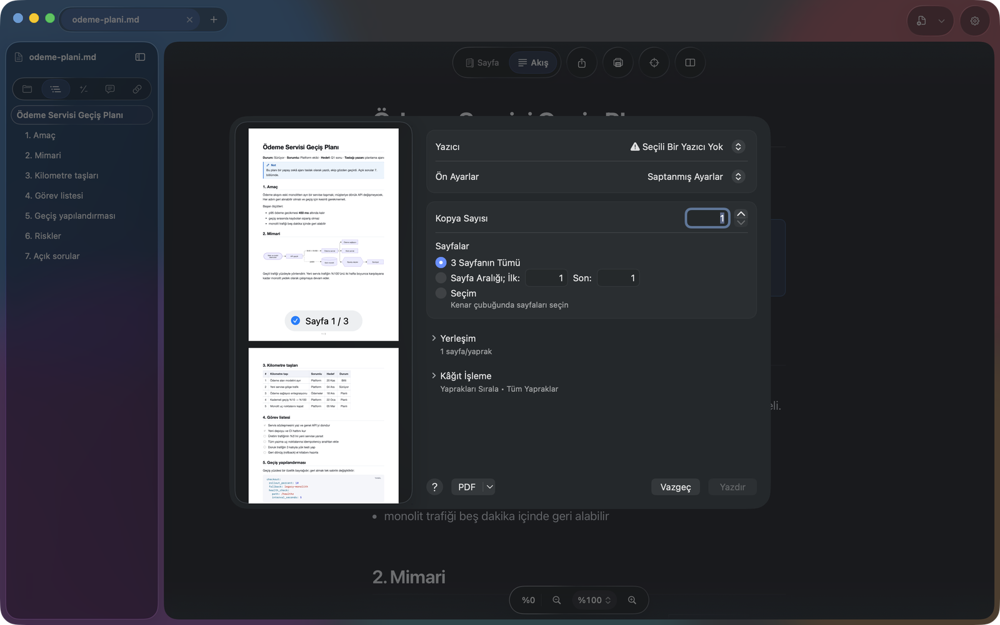
  <br><sub>Yazdırma önizlemesi: koyu temalı belge açık renkli sayfaya basılır.</sub>
</p>

#### Quick Look (Hızlı Bakış)

Finder'da bir Markdown dosyasında **Boşluk** tuşuna basın; aynı oluşturucuyla önizlenir: Mermaid, KaTeX, kod vurgulama, açık ve koyu tema ve Obsidian söz dizimi. Quick Look'ta kasa yoktur; bu yüzden `[[bağlantı]]`lar çözümlenmez, dosyanın yanındaki görseller gösterilmez ve 2 MiB üstü dosyalar düz metin görünür.

#### Ayarlar

Tema, varsayılan görünüm ve yakınlaştırma, yazdırma teması, yeni belgelerin nasıl açılacağı (sekme ya da pencere), takip varsayılanları, Markdown lehçesi, kasa dizinleme önerisi, arayüz dili (Sistem, Türkçe ya da English; yeniden başlatınca uygulanır), uzak görseller ve varsayılan Markdown uygulaması.

<p align="center">
  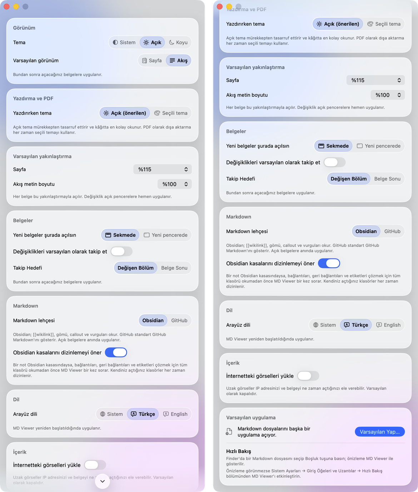
  <br><sub>Ayarlar (pencerenin üst ve alt bölümü yan yana).</sub>
</p>

## Kurulum

1. [DMG'yi indirin](https://github.com/suleymanozcan/md-viewer/releases/latest/download/MDViewer.dmg) (eski sürümler [Sürümler sayfasında](https://github.com/suleymanozcan/md-viewer/releases)).
2. DMG'yi açın ve **MD Viewer**'ı **Applications** kısayoluna sürükleyin.
3. MD Viewer'ı Applications'tan açın. Uygulama Developer ID ile imzalı ve Apple tarafından notarize edilmiştir; bu yüzden sağ tık ▸ Aç gibi bir yola gerek kalmadan açılır. macOS ilk açılışta her zamanki "İnternet'ten indirilmiş" onayını gösterebilir.

**İndirmeyi doğrulayın (isteğe bağlı).** Her sürümde DMG'nin yanında bir SHA-256 özeti listelenir. Mac'inizdekiyle karşılaştırın:

```bash
shasum -a 256 ~/Downloads/MDViewer.dmg
```

**Varsayılan Markdown görüntüleyiciniz yapın.** Uygulamada *MD Viewer ▸ Varsayılan Markdown Görüntüleyici Yap…* komutunu seçin (ya da karşılama penceresindeki ya da Ayarlar'daki düğmeyi kullanın). MD Viewer bunu kendiliğinden asla yapmaz. Dilerseniz Finder'da bir `.md` dosyası seçip **⌘I**'ya basın, *Birlikte Aç* altından MD Viewer'ı seçin ve *Tümünü Değiştir…*'e tıklayın.

**Quick Look'u açın.** Önizleme uzantısı uygulamanın içinde gelir. Uygulamayı Applications'a kopyalayıp bir kez açın. Önizleme yine görünmezse Sistem Ayarları'nı açıp Hızlı Bakış uzantıları listesini arayın (yeni macOS sürümlerinde *Giriş Öğeleri ve Uzantılar* altındadır; tam yol macOS sürümüne göre değişir) ve *MD Viewer Quick Look*'u etkinleştirin. Başka bir Markdown Quick Look uzantısı kuruluysa `.md` dosyalarını bunlardan yalnızca biri ele alabilir.

**Mac App Store: yakında.** MD Viewer'ın Mac App Store'a "MD Viewer – Markdown Reader" adıyla girmesi planlanıyor. Buradaki doğrudan indirme ana kanal olarak kalır.

**Dil.** Arayüz Türkçe ve English olarak sunulur ve sistem dilinizi izler. *Görünüm ▸ Dil* menüsünden ya da Ayarlar'dan değiştirin.

**Görünüm.** macOS 26'da arayüz Liquid Glass kullanır. macOS 14 ve 15'te sistemin yarı saydam malzemelerini kullanır.

## Klavye kısayolları

Tüm kısayollar menülerde de görünür.

| Kısayol | Eylem |
|---|---|
| ⌘O · ⇧⌘O | Aç… · Klasör Aç… |
| ⌘K | Hızlı Geçiş… |
| ⇧⌘F | Kasada Ara… |
| ⌘F · ⌘G · ⇧⌘G | Bul… · Sonrakini Bul · Öncekini Bul |
| ⇧⌘R | Klasörü Yenile |
| ⌥⌘O · ⌥⇧⌘O | Yan Yana Aç… · Bu Belgeyi Yan Yana Aç |
| ⌘W · ⇧⌘W | Sekmeyi Kapat · Pencereyi Kapat |
| ⌘1 … ⌘8 · ⌘9 | 1…8. sekme · son sekme |
| ⇧⌘[ · ⇧⌘] (ayrıca ⌃⇧⇥ · ⌃⇥) | Önceki sekme · Sonraki sekme |
| ⌃⌘1 · ⌃⌘2 | Sayfa görünümü · Akış görünümü |
| ⌥⌘1 … ⌥⌘6 | Kenar çubuğu: Küçük Resimler · İçindekiler · Dosyalar · Değişiklikler · Yorumlar · Bağlantılar |
| ⌃⌘S · ⌃⌥⌘S | Sol kenar çubuğunu gizle/göster · sağ kenar çubuğunu gizle/göster |
| ⇧⌘L | Değişiklikleri Takip Et |
| ⌃⌘X · ⌃⌘Y | Bölmeleri Değiştir · Kaydırmayı Eşitle |
| ⌥⌘← · ⌥⌘→ | Sol bölmeye · sağ bölmeye odaklan |
| ⌘+ · ⌘− · ⌘0 | Yakınlaştır · Uzaklaştır · Varsayılan Yakınlaştırmaya Dön (Türkçe klavye için [SSS](#sık-sorulan-sorular)'ye bakın) |
| ⌃⌘0 · ⌥⌘0 · ⌥⌘9 | Gerçek Boyut · Genişliğe Sığdır · Sayfaya Sığdır |
| ⇧⌘K | Yorum Ekle… |
| ⌥⌘P | Ajana Gönder (Ajan İçin İstemi Kopyala) |
| ⇧⌘E · ⌘P | PDF Olarak Dışa Aktar… · Yazdır… |
| ⌘R · ⌃⌘F | Yeniden Yükle · Tam Ekran |
| ⌘, | Ayarlar |

## Gizlilik

MD Viewer hiçbir veri toplamaz; hesap, analitik ya da izleme içermez ve ağ bağlantısı kurmaz. Uzak görseller varsayılan olarak kapalıdır; açarsanız görsel sunucuları, her web sitesi gibi, IP adresinizi görür. Uygulamanın dosyalarınıza yazdığı tek şeyler, tıkladığınız bir görev kutusu ve `.review.md` yorum yan dosyasıdır. Politikanın tamamı [PRIVACY.md](PRIVACY.md) dosyasında (English ve Türkçe).

## Sık Sorulan Sorular

**Türkçe klavyemde zoom kısayolları çalışmıyor.**
Türkçe PC düzeninde `+` Shift+4, `=` Shift+0 tuşundadır ve ⌘⇧4 gibi sistem kısayollarıyla çakışır. MD Viewer tuşun ürettiği karaktere bakar: yakınlaştırmak için **⌘ ve `*` tuşuna** (0'ın sağındaki tuş, Shift'siz) ya da **⌘ ve sayısal tuş takımındaki `+`'ya**, uzaklaştırmak için **⌘ ve `-`'ye** (ya da tuş takımındaki `-`) basın. ABD düzeninde ⌘+ ve ⌘= çalışır. Bölünmüş görünümde yakınlaştırma etkin bölmeye uygulanır.

**Obsidian söz dizimini nasıl kapatırım?**
Ayarlar ▸ *Markdown* ▸ *Markdown lehçesi* bölümünden **GitHub**'ı seçin. Açık belgeler hemen yeniden çizilir. Otomatik algılama yoktur: varsayılan olarak her belge Obsidian söz dizimiyle okunur. Kasa dizinleme önerisini durdurmak için aynı bölümde *Obsidian kasalarını dizinlemeyi öner*'i kapatın.

**İnternetteki görseller neden görünmüyor?**
Uzak görseller varsayılan olarak kapalıdır; çünkü yüklenmeleri IP adresinizi ve belgeyi ne zaman açtığınızı gösterir. Ayarlar ▸ *İçerik* ▸ *İnternetteki görselleri yükle* ile açabilirsiniz.

**Koyu temada okuyorum ama yazdırma neden açık tema kullanıyor?**
Beyaz kâğıt üzerinde siyah metin daha okunaklıdır ve mürekkep tasarrufu sağlar. Ayarlar ▸ *Yazdırma ve PDF* ▸ *Yazdırırken tema* ile değiştirin. PDF'e aktarma her zaman seçili temayı kullanır.

**Quick Look önizlemesi görünmüyor.**
[Kurulum](#kurulum) bölümüne bakın. Uygulamayı Applications'tan bir kez açın ve Sistem Ayarları'ndaki Hızlı Bakış uzantıları listesini kontrol edin. Yine de görünmüyorsa Terminal'de `qlmanage -r` ile Quick Look önbelleğini sıfırlayın.

**MD Viewer dosyalarımı düzenler mi?**
Yalnızca iki durumda: bir görev kutusuna tıkladığınızda (`.md` dosyası güncellenir; ⌘Z geri alır) ve yorum eklediğinizde (ayrı bir `<ad>.md.review.md` dosyasına kaydedilir; belgenin kendisi değişmez). Geri kalan her şey salt okunurdur.

**Yorumlarım nerede saklanıyor?**
Belgenin yanında, `<ad>.md.review.md` dosyasında. Düz Markdown'dır. Belgeyle birlikte saklayın ya da işiniz bitince silin.

**MD Viewer güncellemeleri kendisi denetler mi?**
Hayır. Yeni sürümleri [Sürümler sayfasından](https://github.com/suleymanozcan/md-viewer/releases) indirin. [Değişiklik günlüğü](CHANGELOG.md) neyin değiştiğini listeler.

## Geri bildirim

Bir hata mı buldunuz ya da bir fikriniz mi var? [Issue açın](https://github.com/suleymanozcan/md-viewer/issues/new/choose); form macOS sürümünüzü, MD Viewer sürümünü ve küçük bir Markdown örneğini ister. Lütfen özel belgelerinizi eklemeyin. Ayrıca [hello@minata.dev](mailto:hello@minata.dev) adresine yazabilirsiniz. Daha fazlası [SUPPORT.md](SUPPORT.md) ve [kullanım kılavuzunda](docs/USAGE.tr.md).

## Hakkında

MD Viewer, **Minata Entertainment, LLC** tarafından geliştirilir. Minata Entertainment, Türkiye'nin Antalya kentinde çalışan, ABD'nin Delaware eyaletinde limited şirket olarak kurulmuş bir stüdyodur. Bir ürünü ilk fikirden yayın sürümüne kadar (mimari, arka uç, istemci, mağaza sayfası) götürür ve çıkıştan sonra da yanında kalır.

[minata.dev](https://minata.dev/tr/) · [hello@minata.dev](mailto:hello@minata.dev)

## Lisans

MD Viewer ticari işler dahil kullanımı ücretsizdir ve değiştirilmemiş DMG'yi yeniden dağıtabilirsiniz. Kapalı kaynaklı bir yazılımdır ve garanti verilmez. Bkz. [LICENSE](LICENSE) (İngilizce). Uygulamaya paketlenen kütüphaneler kendi lisanslarını korur; [THIRD_PARTY_NOTICES.md](THIRD_PARTY_NOTICES.md) dosyasında listelenir.

© 2026 Minata Entertainment, LLC
