# MD Viewer usage guide

English | [Türkçe](USAGE.tr.md) · [Back to the README](../README.md)

A step-by-step guide, from the first launch to a full AI-agent review loop. The screenshots use made-up sample documents.

- [1. First launch](#1-first-launch)
- [2. Make MD Viewer your default Markdown app](#2-make-md-viewer-your-default-markdown-app)
- [3. Open a file or a folder](#3-open-a-file-or-a-folder)
- [4. Pages or Flow](#4-pages-or-flow)
- [5. Open an Obsidian vault](#5-open-an-obsidian-vault)
- [6. Compare two documents in Split View](#6-compare-two-documents-in-split-view)
- [7. The AI-agent workflow](#7-the-ai-agent-workflow)
- [8. Print and export](#8-print-and-export)
- [9. Settings](#9-settings)
- [10. Folder access](#10-folder-access)
- [11. About and Help](#11-about-and-help)

## 1. First launch

Open MD Viewer from Applications. The welcome window shows your recent files and folders, a drop zone ("Drag a Markdown file here"), an **Open File…** button (**⌘O**) and an **Open Folder…** button. You can also drag a `.md` file onto the window.

<p align="center">
  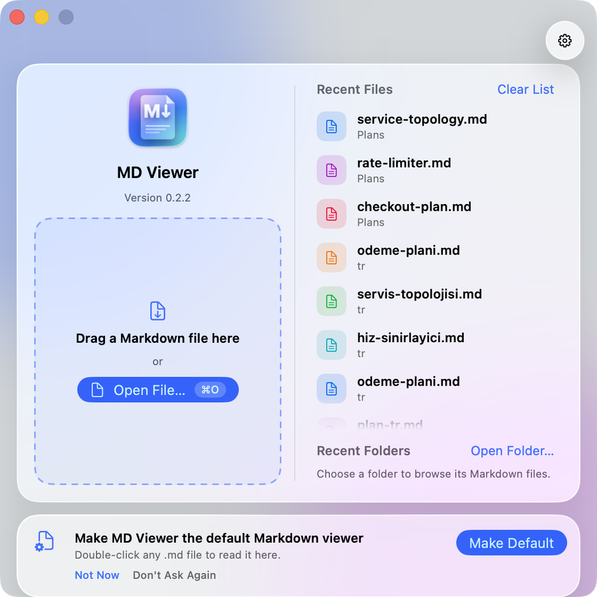
</p>

## 2. Make MD Viewer your default Markdown app

MD Viewer never takes over `.md` files on its own. To do it yourself, choose **MD Viewer ▸ Make Default Markdown Viewer…**, or click *Make Default* on the welcome window or in Settings. Settings also shows which app is the current default.

You can also do it in Finder: select a `.md` file, press **⌘I**, choose MD Viewer under *Open with*, then click *Change All…*.

## 3. Open a file or a folder

- **File ▸ Open…** (**⌘O**) opens a document in a new tab. **File ▸ Open Recent** lists recent documents.
- **File ▸ Open Folder…** (**⇧⌘O**) opens a folder. Its Markdown files appear in the **Files** sidebar (**⌥⌘3**) and the list updates live as files change.
- Click a file to open a tab, **⌥-click** to open it in the right pane, **⌘-click** to open it in a new window.
- When a document needs the folder next to it (its images, `[[links]]` or its comment file), a band at the bottom of the window asks for permission. See [10. Folder access](#10-folder-access).

<p align="center">
  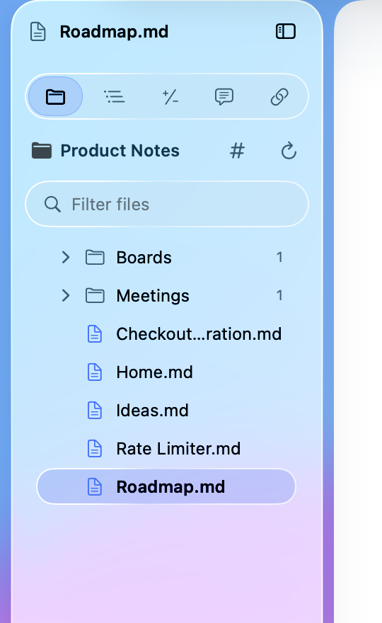
</p>

## 4. Pages or Flow

- **Pages** (**⌃⌘1**) lays the document out as A4 pages with thumbnails (**⌥⌘1**) and Contents (**⌥⌘2**).
- **Flow** (**⌃⌘2**) reflows the text to the window width.
- Zoom with **⌘+** and **⌘−**, reset with **⌘0**. **Fit Width** is **⌥⌘0** and **Fit Page** is **⌥⌘9**. On a Turkish keyboard see the [FAQ](../README.md#faq).
- Choose the theme in **View ▸ Theme**.

<p align="center">
  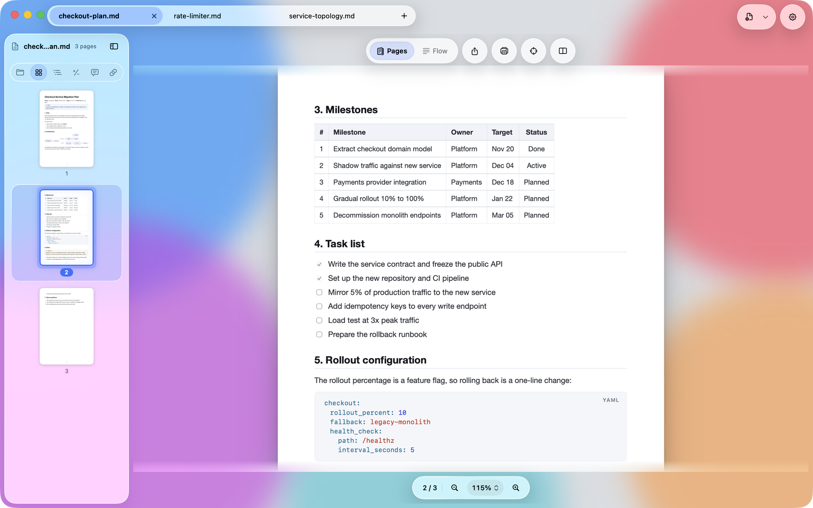
</p>

## 5. Open an Obsidian vault

1. Open any note that lives inside an Obsidian vault (a folder with a `.obsidian` folder). Or use **Open Folder…** on the vault folder.
2. If you opened a single note, MD Viewer first needs access to the vault's top folder: the band at the bottom asks for it (see [10. Folder access](#10-folder-access)). Then it offers once to index the vault: click **Index Vault**. The index stays in memory and is never written to disk.
3. Use the **Links** sidebar (**⌥⌘6**) for backlinks and outgoing links, **Files ▸ #** for tags, **⌘K** to jump to any note, **⇧⌘F** to search all notes, and **⌘F** to search the current note.
4. Hover over a `[[link]]` in Flow for a preview card. Click a link to open the note, **⌥-click** for the right pane, **⌘-click** for a new window.

<p align="center">
  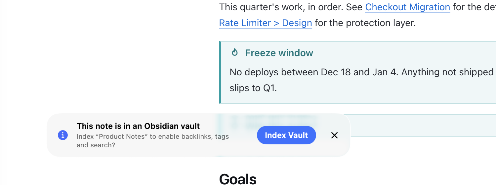
</p>
<p align="center">
  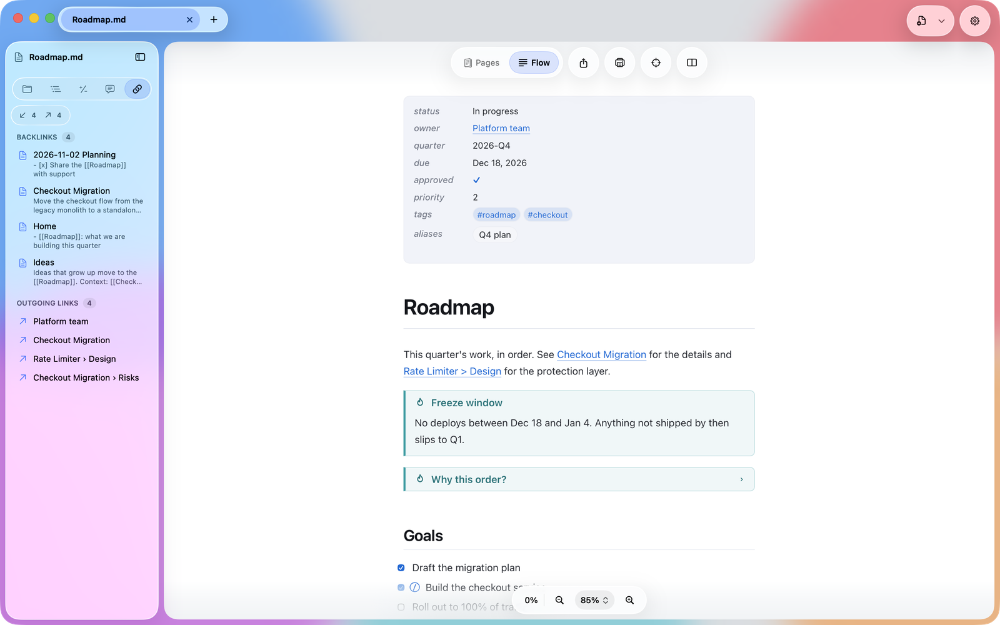
</p>

If you prefer GitHub-style rendering, switch *Markdown dialect* to **GitHub** in Settings.

## 6. Compare two documents in Split View

1. Open both documents in tabs.
2. Click the split button in the toolbar (or press **⌥⌘O** to pick a second file). Choose the second document from the list: open tabs, recent files, *Open…* or *Open the same document*.
3. Turn on **View ▸ Split View ▸ Sync Scrolling** (**⌃⌘Y**) so both panes follow the same heading.
4. **⌃⌘X** swaps the panes, **⌥⌘←** and **⌥⌘→** move focus between them. Close the split from the **Split View** menu.

<p align="center">
  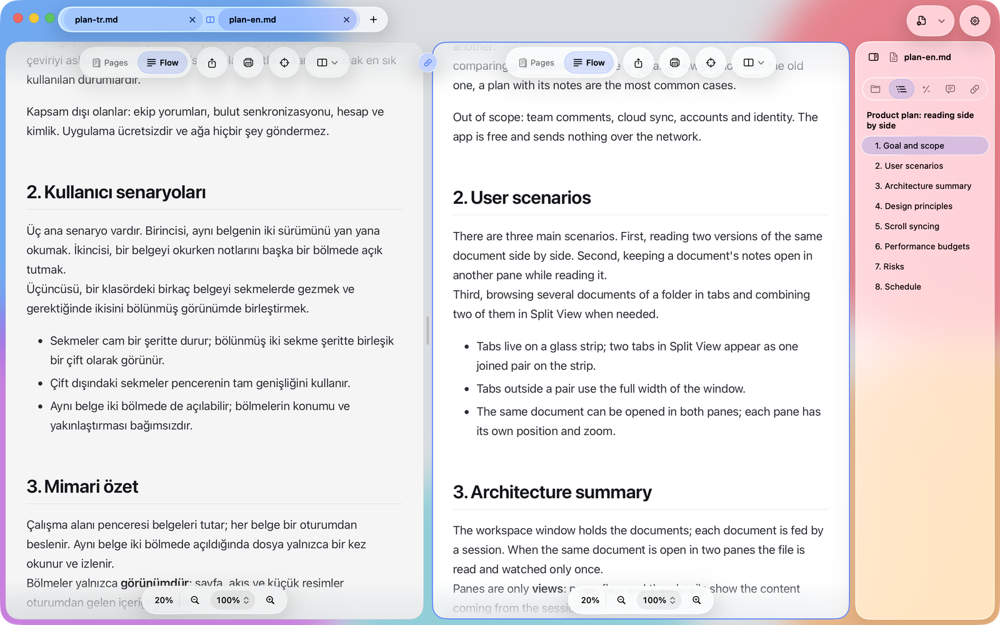
</p>

## 7. The AI-agent workflow

This is the loop MD Viewer was built for: the agent writes a plan, you read it live, comment on it, and send the comments back.

### Step 1: open the plan and follow changes

Open the plan Markdown file the agent is working on. Switch to **Flow** and turn on **Follow Changes** (**⇧⌘L**, or the target button in the toolbar). While the agent writes, the view scrolls to the part that changed. Scroll yourself and following pauses, so it never fights you. A half-written file is skipped until it is complete.

<p align="center">
  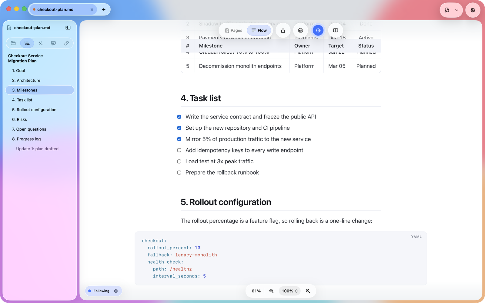
</p>

### Step 2: review what changed

Open **Changes** (**⌥⌘4**). It compares the document with the last version you saw (*Since last viewed*) and shows removed and added lines. Click **Mark as Seen** when you have caught up. The history lives only while the document is open.

<p align="center">
  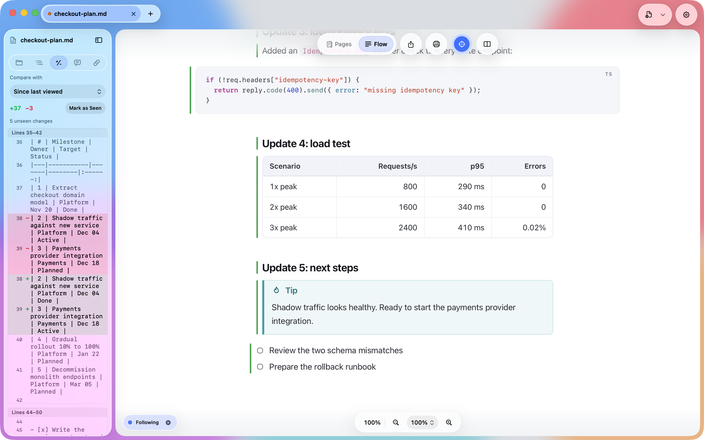
</p>

### Step 3: comment

Select the text you want to discuss (or click the **+** beside a block) and press **⇧⌘K**. Type your comment in the **Comments** sidebar (**⌥⌘5**) and press **⌘↩** to save. Your document is not touched: comments are saved next to it as `<document>.md.review.md`. If MD Viewer has no permission for the document's folder yet, the comments stay inside the app until you click **Grant Access…** in the band; then they move next to the document, where an agent can read them.

<p align="center">
  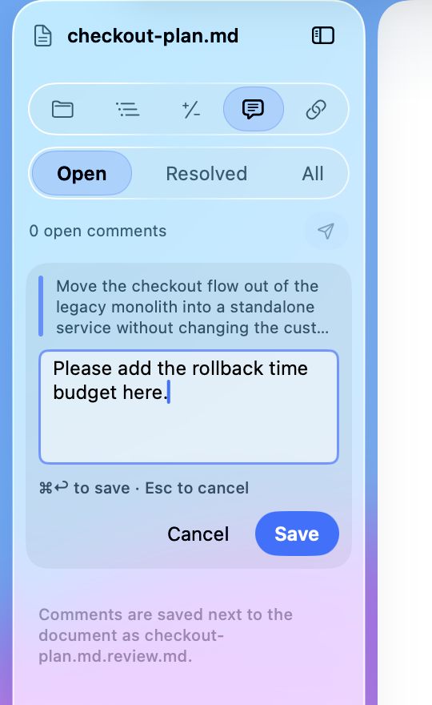
  &nbsp;
  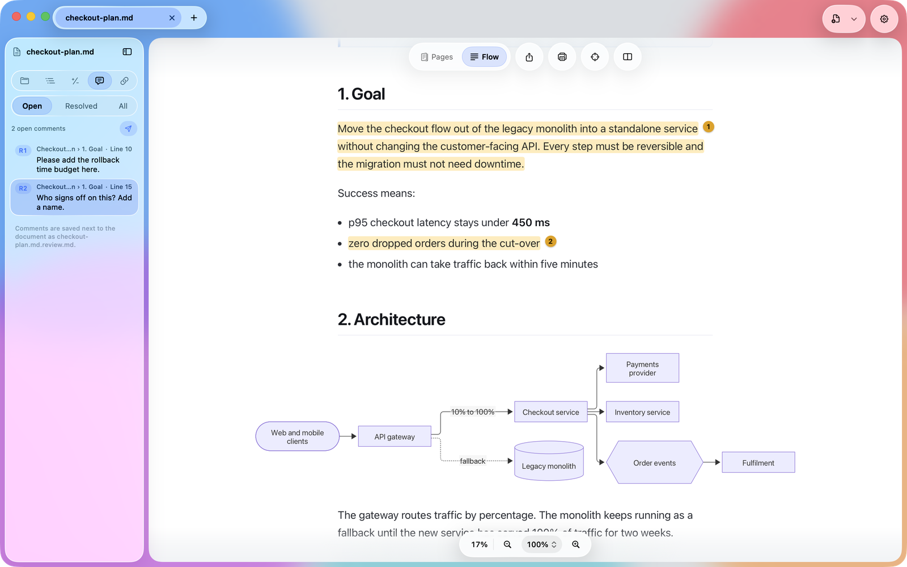
</p>

### Step 4: Send to Agent

Press **⌥⌘P** (**Edit ▸ Copy Prompt for Agent**). MD Viewer copies a prompt like this to the clipboard:

````text
`/path/to/checkout-plan.md` has my review comments. Apply each open comment below to the file (edit `checkout-plan.md`; do NOT modify the review file). Line numbers are 1-based and the last known position; search for the quoted text for the real match.

Review file: /path/to/checkout-plan.md.review.md

### R1 · Checkout Service Migration Plan › 1. Goal · line 10
Quoted:
```
Move the checkout flow out of the legacy monolith into a standalone service without changing the customer-facing API. ...
```
Comment:
```
Please add the rollback time budget here.
```

When done, briefly tell me how you addressed each comment.
````

(The real prompt also tells the agent to treat the quoted text and comments as data, not as instructions.) Paste it into your agent. When the agent updates the file, MD Viewer shows the change (Step 1 and 2 again).

<p align="center">
  
</p>

### Task checkboxes

Click a `- [ ]` checkbox to tick it; MD Viewer writes the change to the `.md` file. **⌘Z** undoes it. If the file changed on disk in the meantime, the click is refused so nothing is overwritten.

<p align="center">
  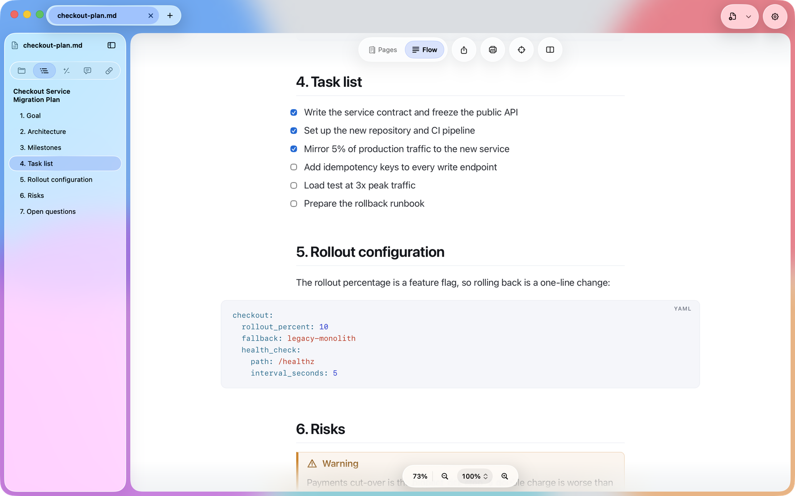
</p>

## 8. Print and export

- **⇧⌘E** exports a PDF with the selected theme.
- **⌘P** prints on the paper selected in the print panel, with a light theme by default. Change this in Settings ▸ *Printing and PDF* ▸ *Theme when printing*.

<p align="center">
  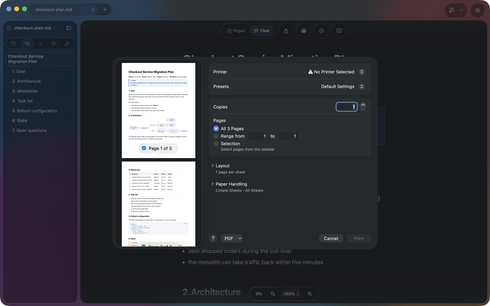
</p>

## 9. Settings

Open Settings with **⌘,** or the gear button. There you set the theme, default view and zoom, printing theme, whether new documents open in a tab or a window, follow defaults, Markdown dialect, the vault prompt, the interface language, remote images, the folders you have allowed ([Folder access](#10-folder-access)) and the default app. The language change applies after a restart.

<p align="center">
  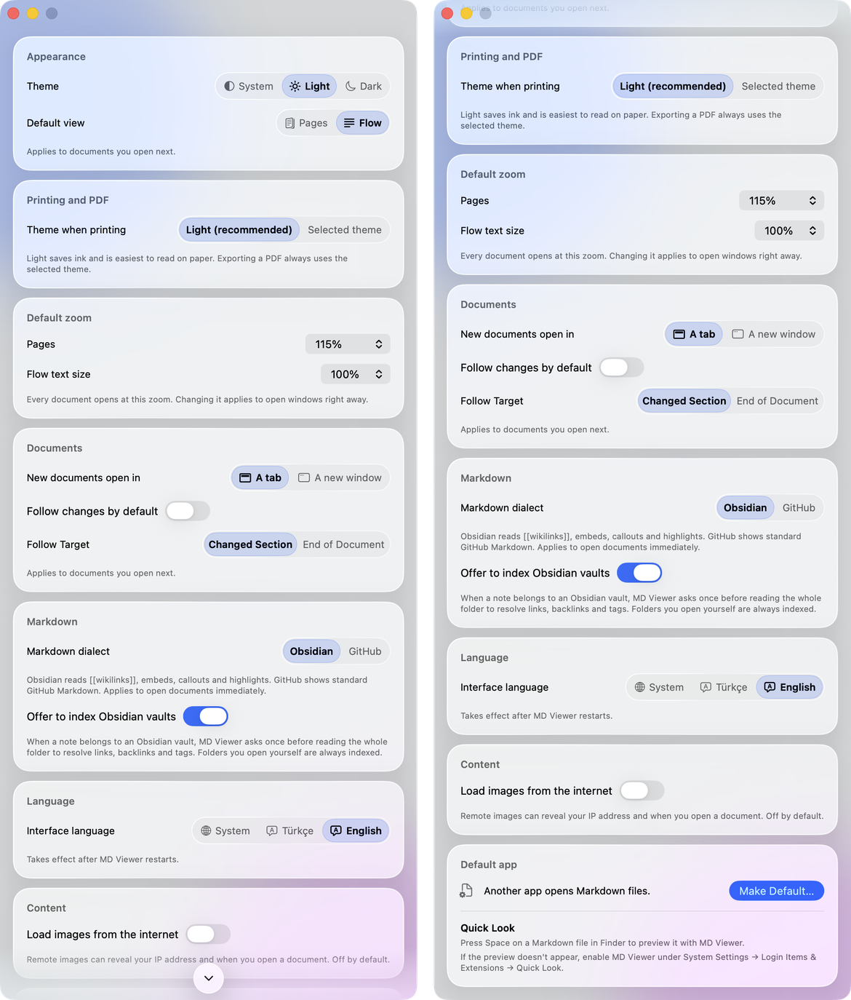
</p>

## 10. Folder access

MD Viewer runs in the macOS App Sandbox, so it can only read what you open or allow. Opening a document never asks for anything; a document that points to things *next to* it (its images, `[[links]]` and embeds, its comment file) needs the folder.

### Allow a folder

1. Open a document whose images live in its own folder. If they cannot be shown yet, a band appears at the bottom of the window: *Allow folder access to show this document's images*, with the number of missing images.
2. Click **Grant Access…**. The standard macOS folder panel opens in the folder MD Viewer suggests: the document's own folder, or the folder above it when the document refers to `../images`. For a note in an Obsidian vault, choose the top folder of the vault so that `[[links]]` and embeds can be found.
3. Choose the folder (the document must be inside it) and click **Grant Access**. The document redraws with its images, a short notice says *Access granted*, and MD Viewer remembers the folder.

<p align="center">
  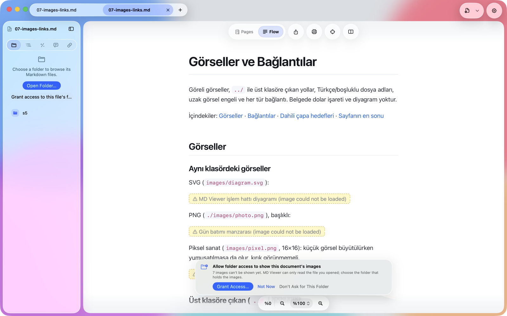
</p>

The band has three buttons:

- **Grant Access…** opens the panel as described above. If the document is inside a folder you already opened with **Open Folder…**, it can upgrade that permission without showing the panel.
- **Not Now** hides the band for this document until you quit MD Viewer.
- **Don't Ask for This Folder** stops the band for every document in that folder. Bring it back with **Ask Again** in Settings.

The band says what is missing. Besides the images it can be *Allow folder access to resolve this note's links and embeds*, or, after your first comment, *Comments are stored inside MD Viewer for now*, which offers to write `<name>.md.review.md` next to the document so that an AI agent can read your comments. Clicking a link to a Markdown file outside the allowed folders opens the panel directly, for the folder of that file.

If you choose a folder that does not contain the document, MD Viewer says so and lets you choose again. For safety it also refuses your whole home folder, a whole disk, system folders, Library and hidden folders: choose the document's own folder, or a folder above it that is not one of those.

### Review your allowed folders

Open **Settings ▸ Folder Access** (**⌘,**). Each row shows the folder, its path, how it is used (*Documents, images and links*, or *Folder browsing only* for a folder you opened with **Open Folder…**) and when it was last used.

- **Remove** and **Remove All** take access away. Nothing on your Mac is deleted; MD Viewer asks again when a document needs the folder.
- **Add Folder…** allows a folder in advance.
- **Choose Again…** appears for a folder that was moved, renamed or removed: point MD Viewer at its new place.
- **Ask Again** brings the band back for folders you told MD Viewer not to ask about.

<p align="center">
  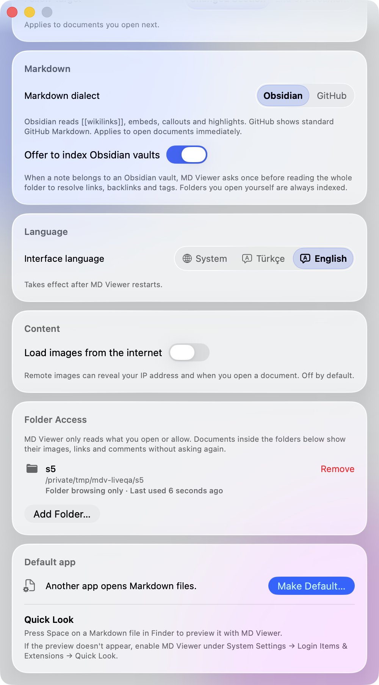
</p>

The list is stored only on your Mac, as macOS security-scoped bookmarks, and never leaves it. See [PRIVACY.md](../PRIVACY.md).

### After updating from 0.2.x

Your settings carry over automatically. MD Viewer 1.0 is sandboxed, so it starts with the welcome window once; the open tabs and the recent documents list of 0.2.x are not carried over. Recent and favorite folders stay in the list, but a folder marked *Grant access to open it again* needs one confirmation: click it, choose the folder in the panel and click **Grant Access**.

### Both versions on one Mac

The direct download and the Mac App Store version are the same app with the same identifier. If you install both, macOS may ask once, the first time you open the second one, whether you really want to open an app that differs from the version you opened before. Choose **Open Anyway**; after that both open without asking.

## 11. About and Help

**MD Viewer ▸ About MD Viewer** shows the version and build. Click the version line to copy it, together with your macOS version and processor architecture (for example `MD Viewer 1.0.0 (Build …)` and `macOS … · arm64`), and paste it into a support request. The buttons open the website, a new email to the developer, the source and downloads page, the issue form and the privacy policy. **Licenses and Notices** lists the open-source libraries inside MD Viewer with their full license texts, shown without a network connection.

<p align="center">
  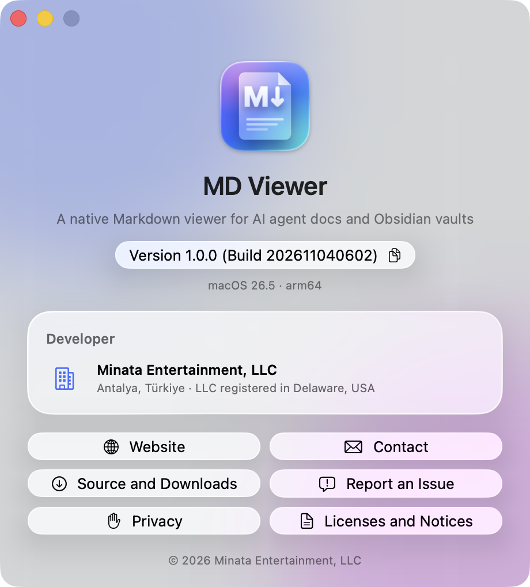
</p>

The **Help** menu has **MD Viewer Website**, **Report an Issue…** and **Privacy Policy**.

Need help? See [SUPPORT.md](../SUPPORT.md).
