# MD Viewer kullanım kılavuzu

[English](USAGE.md) | Türkçe · [README'ye dön](../README.tr.md)

İlk açılıştan yapay zekâ ajanıyla tam bir inceleme döngüsüne kadar adım adım kılavuz. Ekran görüntülerinde uydurma örnek belgeler kullanılmıştır.

- [1. İlk açılış](#1-i̇lk-açılış)
- [2. MD Viewer'ı varsayılan Markdown uygulaması yapın](#2-md-viewerı-varsayılan-markdown-uygulaması-yapın)
- [3. Dosya ya da klasör açın](#3-dosya-ya-da-klasör-açın)
- [4. Sayfa ya da Akış](#4-sayfa-ya-da-akış)
- [5. Obsidian kasası açın](#5-obsidian-kasası-açın)
- [6. İki belgeyi bölünmüş görünümde karşılaştırın](#6-i̇ki-belgeyi-bölünmüş-görünümde-karşılaştırın)
- [7. Yapay zekâ ajanı iş akışı](#7-yapay-zekâ-ajanı-iş-akışı)
- [8. Yazdırma ve dışa aktarma](#8-yazdırma-ve-dışa-aktarma)
- [9. Ayarlar](#9-ayarlar)
- [10. Klasör erişimi](#10-klasör-erişimi)
- [11. Hakkında penceresi ve Yardım menüsü](#11-hakkında-penceresi-ve-yardım-menüsü)

## 1. İlk açılış

MD Viewer'ı Applications'tan açın. Karşılama penceresi son dosyalarınızı ve klasörlerinizi, bir bırakma alanını ("Bir Markdown dosyasını buraya sürükleyin"), **Dosya Aç…** düğmesini (**⌘O**) ve **Klasör Aç…** düğmesini gösterir. Bir `.md` dosyasını pencereye sürükleyip de bırakabilirsiniz.

<p align="center">
  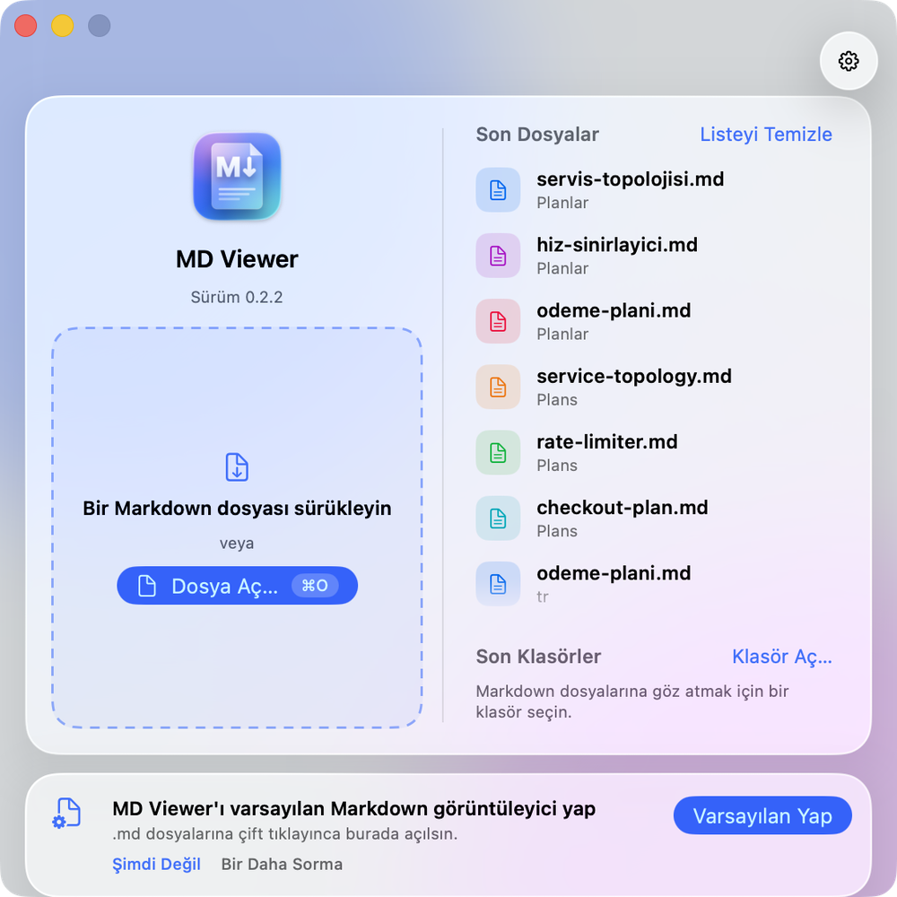
</p>

## 2. MD Viewer'ı varsayılan Markdown uygulaması yapın

MD Viewer `.md` dosyalarını kendiliğinden asla devralmaz. Kendiniz yapmak için **MD Viewer ▸ Varsayılan Markdown Görüntüleyici Yap…** komutunu seçin ya da karşılama penceresindeki ya da Ayarlar'daki *Varsayılan Yap* düğmesine tıklayın. Ayarlar ayrıca şu anda hangi uygulamanın varsayılan olduğunu gösterir.

Finder'da da yapabilirsiniz: bir `.md` dosyası seçin, **⌘I**'ya basın, *Birlikte Aç* altından MD Viewer'ı seçin ve *Tümünü Değiştir…*'e tıklayın.

## 3. Dosya ya da klasör açın

- **Dosya ▸ Aç…** (**⌘O**) bir belgeyi yeni sekmede açar. **Dosya ▸ Son Açılanlar** son belgeleri listeler.
- **Dosya ▸ Klasör Aç…** (**⇧⌘O**) bir klasör açar. Markdown dosyaları **Dosyalar** kenar çubuğunda (**⌥⌘3**) görünür ve dosyalar değiştikçe liste canlı güncellenir.
- Bir dosyaya tıklayınca sekme açılır; **⌥-tık** sağ bölmede, **⌘-tık** yeni pencerede açar.
- Bir belge yanındaki klasöre ihtiyaç duyduğunda (görselleri, `[[bağlantıları]]` ya da yorum dosyası), pencerenin altındaki bir şerit izin ister. Bkz. [10. Klasör erişimi](#10-klasör-erişimi).

<p align="center">
  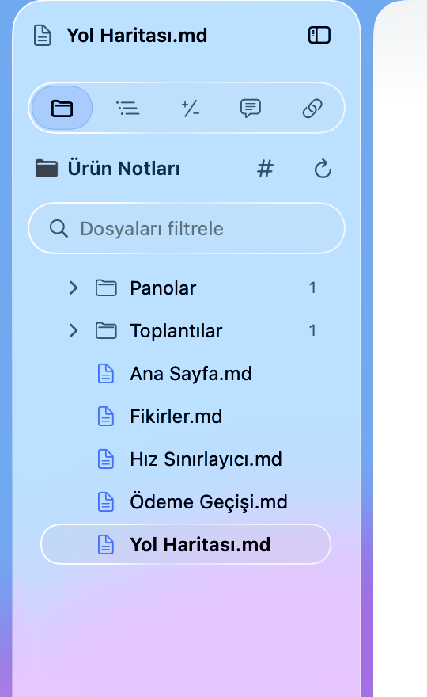
</p>

## 4. Sayfa ya da Akış

- **Sayfa** (**⌃⌘1**) belgeyi küçük resimler (**⌥⌘1**) ve İçindekiler (**⌥⌘2**) ile A4 sayfalar olarak dizer.
- **Akış** (**⌃⌘2**) metni pencere genişliğine göre yeniden akıtır.
- **⌘+** ve **⌘−** ile yakınlaştırın, **⌘0** ile sıfırlayın. **Genişliğe Sığdır** **⌥⌘0**, **Sayfaya Sığdır** **⌥⌘9**'dur. Türkçe klavye için [SSS](../README.tr.md#sık-sorulan-sorular)'ye bakın.
- Temayı **Görünüm ▸ Tema** menüsünden seçin.

<p align="center">
  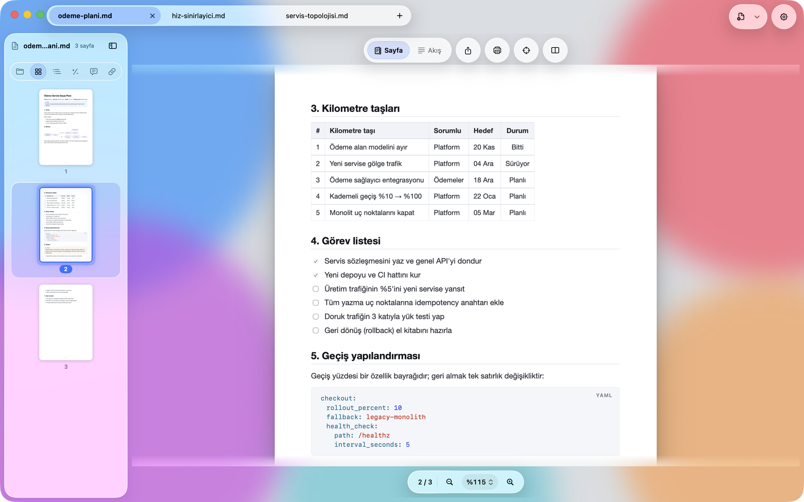
</p>

## 5. Obsidian kasası açın

1. Bir Obsidian kasasının (içinde `.obsidian` klasörü olan klasör) içindeki herhangi bir notu açın. Ya da kasa klasöründe **Klasör Aç…** kullanın.
2. Tek bir not açtıysanız MD Viewer önce kasanın en üst klasörüne erişime ihtiyaç duyar: alttaki şerit bunu ister ([10. Klasör erişimi](#10-klasör-erişimi)). Ardından kasayı dizinlemeyi bir kez önerir: **Kasayı Dizinle**'ye tıklayın. Dizin bellekte kalır ve diske yazılmaz.
3. Geri ve giden bağlantılar için **Bağlantılar** kenar çubuğunu (**⌥⌘6**), etiketler için **Dosyalar ▸ #**'i, herhangi bir nota geçmek için **⌘K**'yı, tüm notlarda aramak için **⇧⌘F**'yi, geçerli notta aramak için **⌘F**'yi kullanın.
4. Akış'ta bir `[[bağlantı]]` üzerine gelince önizleme kartı görünür. Bağlantıya tıklayınca not açılır; **⌥-tık** sağ bölmede, **⌘-tık** yeni pencerede açar.

<p align="center">
  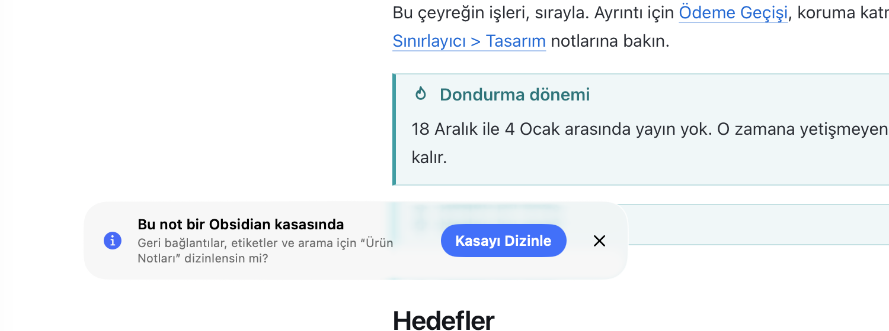
</p>
<p align="center">
  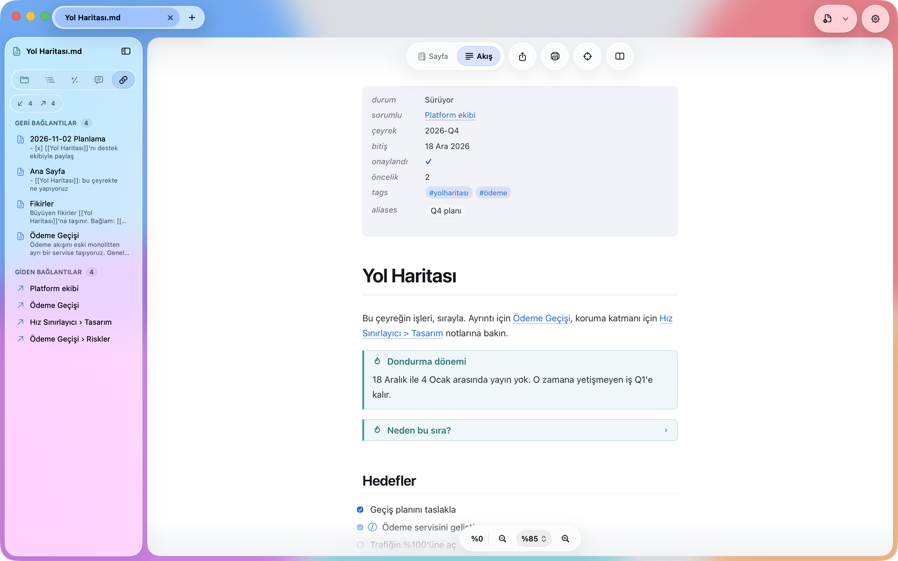
</p>

GitHub tarzı görünümü tercih ederseniz Ayarlar'da *Markdown lehçesi*ni **GitHub**'a çevirin.

## 6. İki belgeyi bölünmüş görünümde karşılaştırın

1. Her iki belgeyi sekmelerde açın.
2. Araç çubuğundaki bölme düğmesine tıklayın (ya da ikinci bir dosya seçmek için **⌥⌘O**'ya basın). İkinci belgeyi listeden seçin: açık sekmeler, son dosyalar, *Aç…* ya da *Aynı belgeyi aç*.
3. İki bölme de aynı başlığı izlesin diye **Görünüm ▸ Bölünmüş Görünüm ▸ Kaydırmayı Eşitle**'yi (**⌃⌘Y**) açın.
4. **⌃⌘X** bölmeleri değiştirir; **⌥⌘←** ve **⌥⌘→** odağı aralarında taşır. Bölmeyi **Bölünmüş Görünüm** menüsünden kapatın.

<p align="center">
  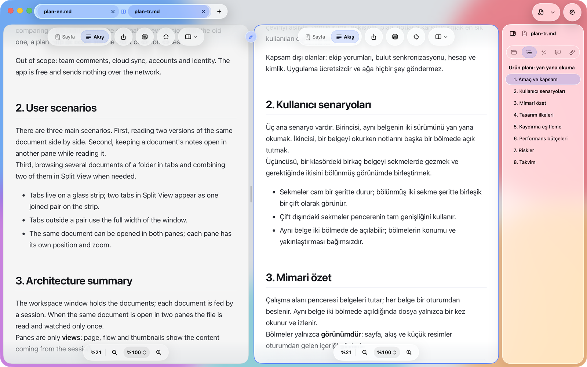
</p>

## 7. Yapay zekâ ajanı iş akışı

MD Viewer'ın tam olarak bunun için yapıldığı döngü: ajan bir plan yazar, siz onu canlı okur, yorumlarsınız ve yorumları ajana geri gönderirsiniz.

### 1. adım: planı açın ve değişiklikleri takip edin

Ajanın üzerinde çalıştığı plan Markdown dosyasını açın. **Akış**'a geçin ve **Değişiklikleri Takip Et**'i açın (**⇧⌘L** ya da araç çubuğundaki hedef düğmesi). Ajan yazarken görünüm değişen bölüme kayar. Siz kendiniz kaydırırsanız takip durur; yani sizinle hiç yarışmaz. Yarım yazılmış dosya tamamlanana kadar atlanır.

<p align="center">
  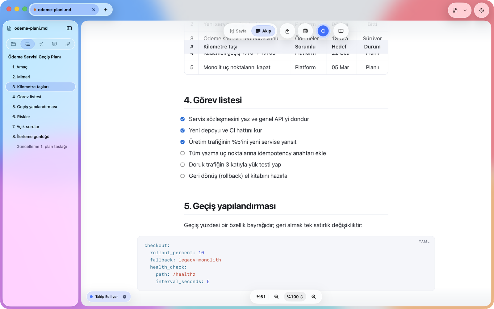
</p>

### 2. adım: neyin değiştiğine bakın

**Değişiklikler**'i açın (**⌥⌘4**). Belgeyi en son gördüğünüz sürümle karşılaştırır (*Son görüldüğünden beri*) ve silinen ve eklenen satırları gösterir. Yetiştiğinizde **Gördüm Olarak İşaretle**'ye tıklayın. Geçmiş yalnızca belge açıkken yaşar.

<p align="center">
  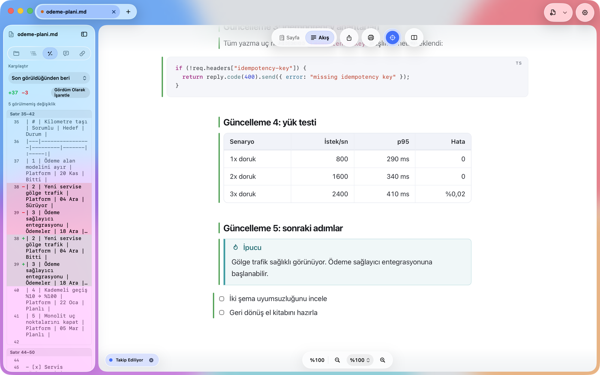
</p>

### 3. adım: yorum bırakın

Üzerinde konuşmak istediğiniz metni seçin (ya da bir bloğun yanındaki **+** işaretine tıklayın) ve **⇧⌘K**'ya basın. Yorumunuzu **Yorumlar** kenar çubuğuna (**⌥⌘5**) yazın ve kaydetmek için **⌘↩**'e basın. Belgenize dokunulmaz: yorumlar yanında `<belge>.md.review.md` olarak saklanır. MD Viewer belgenin klasörü için henüz izin almadıysa yorumlar, şeritteki **Erişim Ver…**'e tıklayana kadar uygulamanın içinde kalır; sonra belgenin yanına taşınır ve ajan onları orada okuyabilir.

<p align="center">
  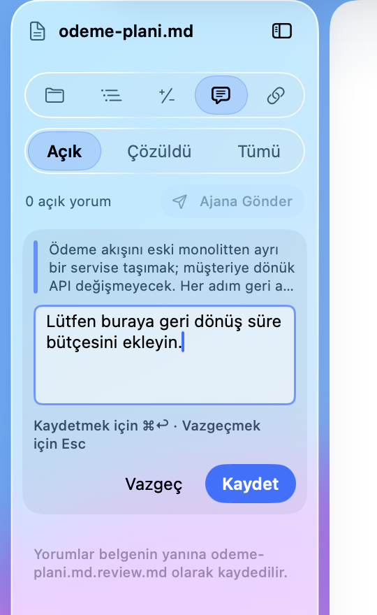
  &nbsp;
  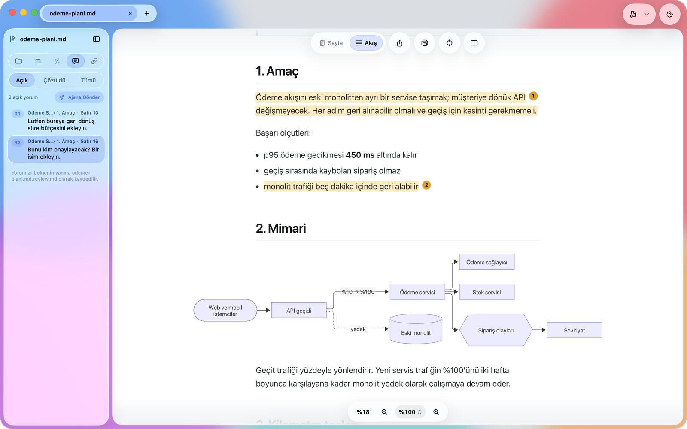
</p>

### 4. adım: Ajana Gönder

**⌥⌘P**'ye basın (**Düzen ▸ Ajan İçin İstemi Kopyala**). MD Viewer panoya şuna benzer bir istem kopyalar (örnek, İngilizce arayüzde kopyalanan metindir):

````text
`/path/to/checkout-plan.md` has my review comments. Apply each open comment below to the file (edit `checkout-plan.md`; do NOT modify the review file). Line numbers are 1-based and the last known position; search for the quoted text for the real match.

Review file: /path/to/checkout-plan.md.review.md

### R1 · Checkout Service Migration Plan › 1. Goal · line 10
Quoted:
```
Move the checkout flow out of the legacy monolith into a standalone service without changing the customer-facing API. ...
```
Comment:
```
Please add the rollback time budget here.
```

When done, briefly tell me how you addressed each comment.
````

(Gerçek istem ayrıca ajana, alıntı metni ve yorumları talimat değil veri olarak ele almasını söyler.) Ajanınıza yapıştırın. Ajan dosyayı güncellediğinde MD Viewer değişikliği gösterir (yeniden 1. ve 2. adım).

<p align="center">
  
</p>

### Görev kutuları

Bir `- [ ]` kutusuna tıklayarak işaretleyin; MD Viewer değişikliği `.md` dosyasına yazar. **⌘Z** geri alır. Bu arada dosya diskte değiştiyse hiçbir şeyin üzerine yazılmaması için tıklama reddedilir.

<p align="center">
  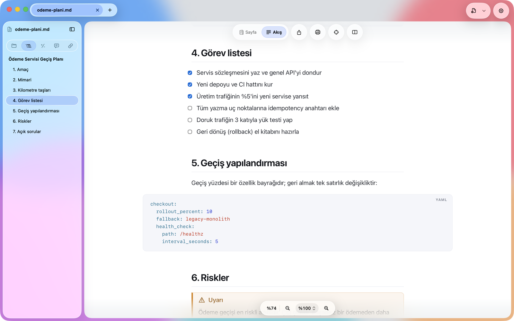
</p>

## 8. Yazdırma ve dışa aktarma

- **⇧⌘E** seçili temayla PDF'e aktarır.
- **⌘P** yazdırma panelinde seçili kâğıda, varsayılan olarak açık temayla yazdırır. Bunu Ayarlar ▸ *Yazdırma ve PDF* ▸ *Yazdırırken tema* ile değiştirin.

<p align="center">
  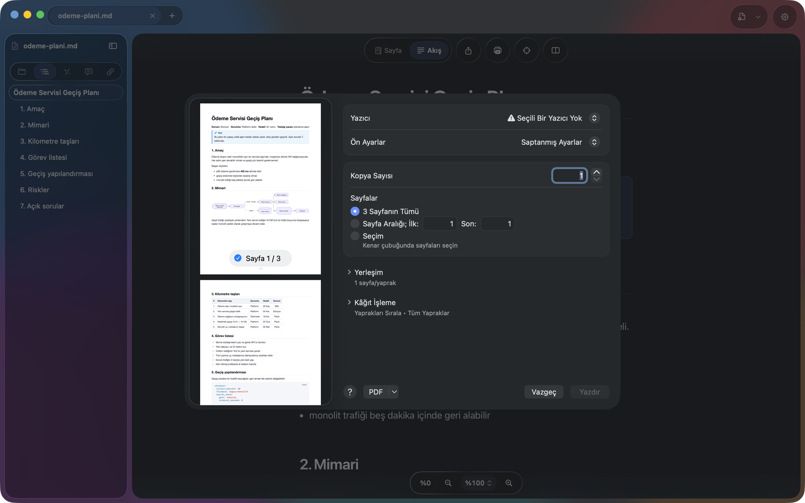
</p>

## 9. Ayarlar

Ayarlar'ı **⌘,** ile ya da dişli düğmesiyle açın. Burada tema, varsayılan görünüm ve yakınlaştırma, yazdırma teması, yeni belgelerin sekmede mi pencerede mi açılacağı, takip varsayılanları, Markdown lehçesi, kasa önerisi, arayüz dili, uzak görseller, izin verdiğiniz klasörler ([Klasör erişimi](#10-klasör-erişimi)) ve varsayılan uygulama ayarlanır. Dil değişikliği yeniden başlatınca uygulanır.

<p align="center">
  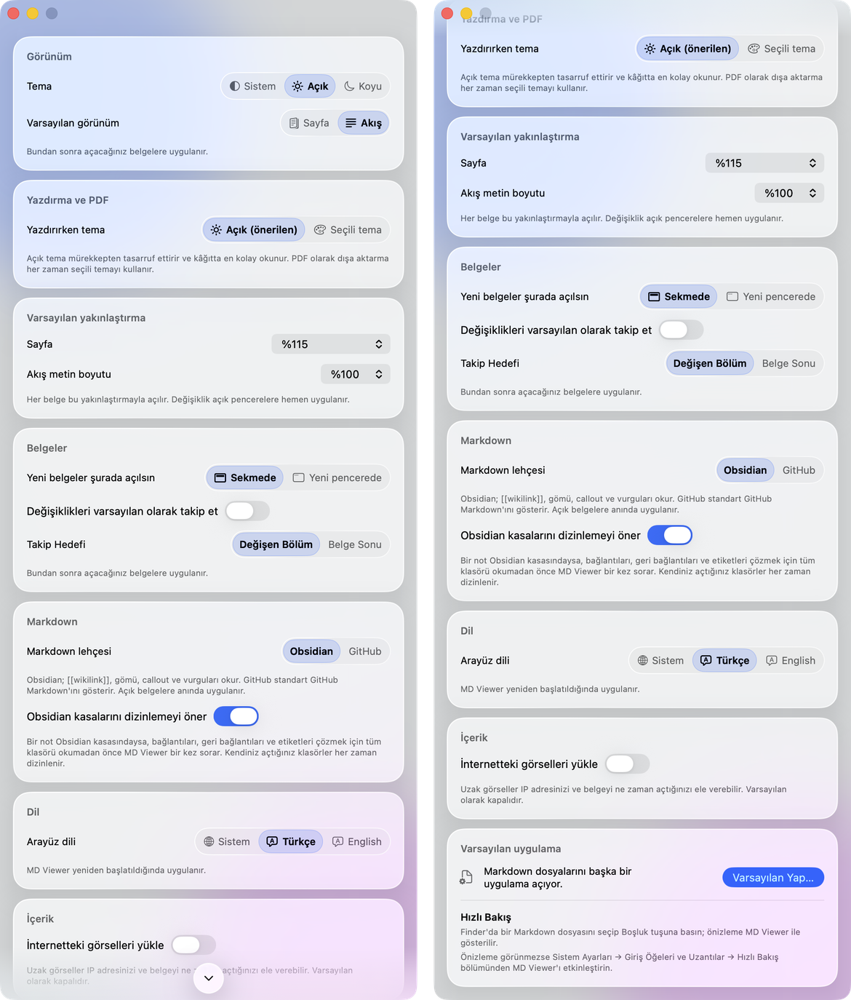
</p>

## 10. Klasör erişimi

MD Viewer macOS App Sandbox (korumalı alan) içinde çalışır; bu yüzden yalnızca açtığınız ya da izin verdiğiniz öğeleri okuyabilir. Bir belgeyi açmak hiçbir zaman izin istemez; belge, *yanındaki* şeylere (görselleri, `[[bağlantıları]]` ve gömüleri, yorum dosyası) işaret ettiğinde klasöre ihtiyaç duyulur.

### Bir klasöre izin verin

1. Görselleri kendi klasöründe duran bir belge açın. Görseller henüz gösterilemiyorsa pencerenin altında bir şerit belirir: *Bu belgedeki resimleri göstermek için klasöre erişim verin*; eksik resim sayısı da yazılır.
2. **Erişim Ver…**'e tıklayın. Standart macOS klasör paneli, MD Viewer'ın önerdiği klasörde açılır: belgenin kendi klasörü ya da belge `../images` gibi bir yola başvuruyorsa bir üst klasör. Bir Obsidian kasasındaki not için, `[[bağlantıların]]` ve gömülerin bulunabilmesi adına kasanın en üst klasörünü seçin.
3. Klasörü seçin (belge onun içinde olmalı) ve **Erişim Ver**'e tıklayın. Belge resimleriyle yeniden çizilir, kısa bir bildirim *Erişim verildi* der ve MD Viewer klasörü hatırlar.

<p align="center">
  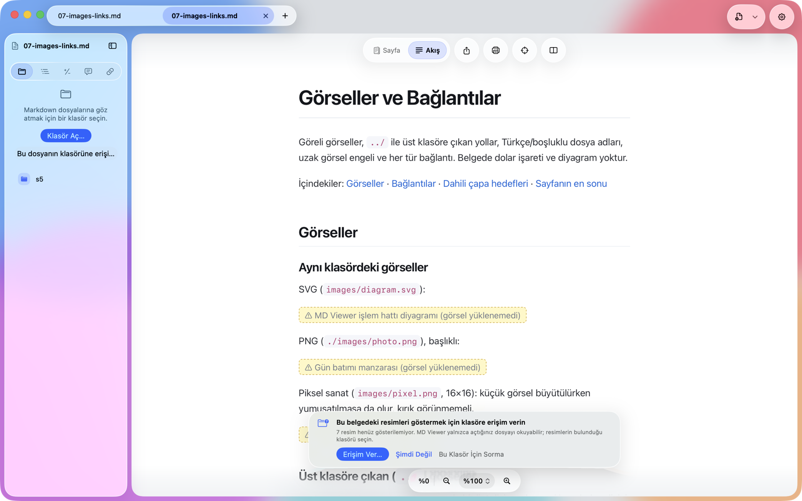
</p>

Şeridin üç düğmesi vardır:

- **Erişim Ver…** paneli yukarıdaki gibi açar. Belge, daha önce **Klasör Aç…** ile açtığınız bir klasörün içindeyse paneli göstermeden o izni yükseltebilir.
- **Şimdi Değil** şeridi, MD Viewer'dan çıkana kadar bu belge için gizler.
- **Bu Klasör İçin Sorma** o klasördeki her belge için şeridi durdurur. Ayarlar'daki **Yeniden Sor** ile geri getirebilirsiniz.

Şerit neyin eksik olduğunu söyler. Resimlerin yanı sıra *Bu notun bağlantılarının ve gömülerinin çözülmesi için klasör erişimi verin* olabilir; ya da ilk yorumunuzdan sonra, ajanın yorumlarınızı okuyabilmesi için `<ad>.md.review.md` dosyasının belgenin yanına yazılmasını öneren *Yorumlar şimdilik MD Viewer'ın içinde saklanıyor* görünür. İzin verilen klasörlerin dışındaki bir Markdown dosyasına giden bağlantıya tıklamak, paneli doğrudan o dosyanın klasörü için açar.

Belgeyi içermeyen bir klasör seçerseniz MD Viewer bunu söyler ve yeniden seçmenize izin verir. Güvenlik için ev klasörünüzün tamamını, bir diskin tamamını, sistem klasörlerini, Library'yi ve gizli klasörleri de reddeder: belgenin kendi klasörünü ya da bunların dışında kalan bir üst klasörü seçin.

### İzin verdiğiniz klasörleri gözden geçirin

**Ayarlar ▸ Klasör Erişimi**'ni açın (**⌘,**). Her satır klasörü, yolunu, nasıl kullanıldığını (*Belgeler, resimler ve bağlantılar* ya da **Klasör Aç…** ile açtığınız klasör için *Yalnızca klasör gezintisi*) ve son kullanım zamanını gösterir.

- **Kaldır** ve **Hepsini Kaldır** erişimi geri alır. Mac'inizde hiçbir şey silinmez; bir belge klasöre ihtiyaç duyduğunda MD Viewer yeniden sorar.
- **Klasör Ekle…** bir klasöre önceden izin verir.
- **Yeniden Seç…** taşınmış, yeniden adlandırılmış ya da silinmiş bir klasör için görünür: MD Viewer'a yeni yerini gösterin.
- **Yeniden Sor**, MD Viewer'a sormamasını söylediğiniz klasörler için şeridi geri getirir.

<p align="center">
  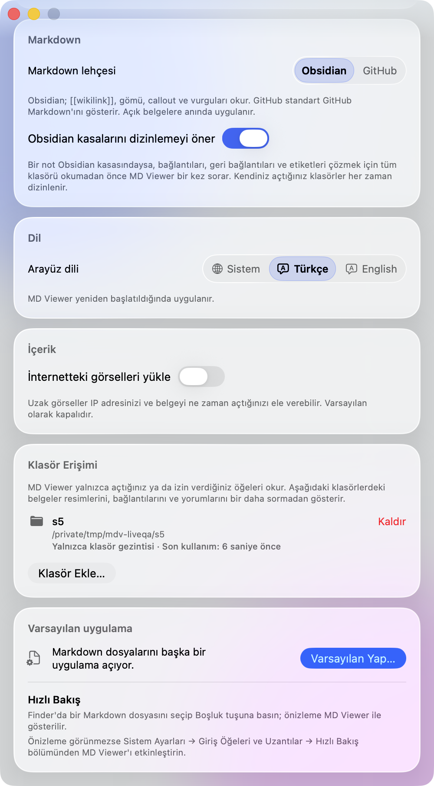
</p>

Liste yalnızca Mac'inizde, macOS güvenlik kapsamlı yer imleri olarak saklanır ve Mac'inizden hiç çıkmaz. Bkz. [PRIVACY.md](../PRIVACY.md).

### 0.2.x'ten güncelledikten sonra

Ayarlarınız kendiliğinden taşınır. MD Viewer 1.0 korumalı alanda çalıştığı için bir kez karşılama penceresiyle açılır; 0.2.x'in açık sekmeleri ve son belgeler listesi taşınmaz. Son ve favori klasörler listede kalır, ancak *Yeniden açmak için erişim verin* yazan bir klasör tek bir onay ister: tıklayın, panelde klasörü seçin ve **Erişim Ver**'e tıklayın.

### İki sürüm aynı Mac'te

Doğrudan indirme ile Mac App Store sürümü aynı kimliğe sahip aynı uygulamadır. İkisini de kurarsanız macOS, ikincisini ilk açtığınızda bir kez, daha önce açtığınız sürümden farklı bir uygulamayı gerçekten açmak isteyip istemediğinizi sorabilir. **Yine de Aç**'ı seçin; sonrasında ikisi de sormadan açılır.

## 11. Hakkında penceresi ve Yardım menüsü

**MD Viewer ▸ MD Viewer Hakkında** sürümü ve derleme numarasını gösterir. Sürüm satırına tıklayınca macOS sürümünüz ve işlemci mimarinizle birlikte (örneğin `MD Viewer 1.0.0 (Build …)` ve `macOS … · arm64`) panoya kopyalanır; destek talebinize yapıştırabilirsiniz. Düğmeler web sitesini, geliştiriciye yeni bir e-postayı, kaynak ve indirmeler sayfasını, sorun formunu ve gizlilik politikasını açar. **Lisanslar ve Bildirimler**, MD Viewer'ın içindeki açık kaynak kütüphaneleri tam lisans metinleriyle, ağ bağlantısı olmadan gösterir.

<p align="center">
  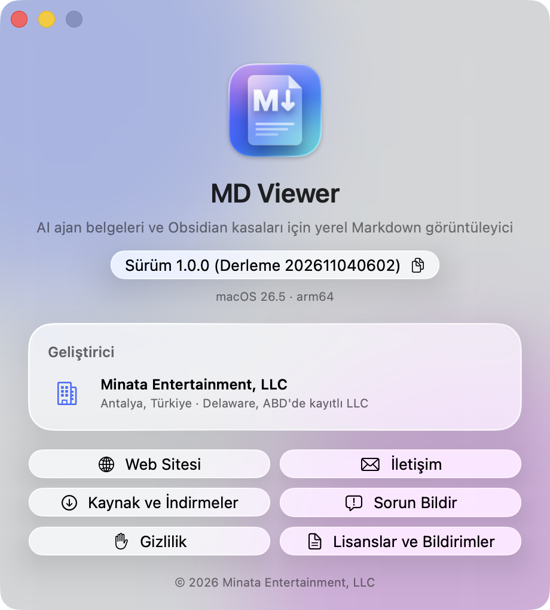
</p>

**Yardım** menüsünde **MD Viewer Web Sitesi**, **Sorun Bildir…** ve **Gizlilik Politikası** bulunur.

Yardım için [SUPPORT.md](../SUPPORT.md) dosyasına bakın.
